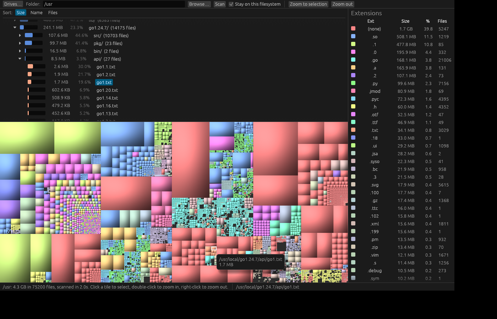

# dirmap

A WinDirStat-style disk usage visualizer written in Rust (egui/eframe).



- **Drive picker** listing every drive (or mounted volume on Linux/macOS) with total, free and used space,
  network drives included. Click one to scan the whole drive, e.g. `D:\`.
- **Parallel scan** (rayon) that never follows symlinks and, by default, stays on one filesystem.
- **Directory tree** sorted by size, name or file count, with percentage bars.
- **Extension list** with totals per file type. Click one to highlight those files in the treemap.
- **Squarified treemap** colored by extension with cushion shading. Hover for the path and size,
  click to select (the tree jumps to it), double-click to zoom into a folder, right-click to zoom out.

## Run

```sh
cargo run --release -- /path/to/scan        # GUI
cargo run --release -- --cli --top 20 ~/    # text report, no window
```

Flags: `--all-fs` descends into other mounted filesystems, `--top N` sets the CLI row count.

On Linux the GUI needs X11 or Wayland plus `libxkbcommon-x11`. It uses the GPU (wgpu) and falls back
to OpenGL automatically.
