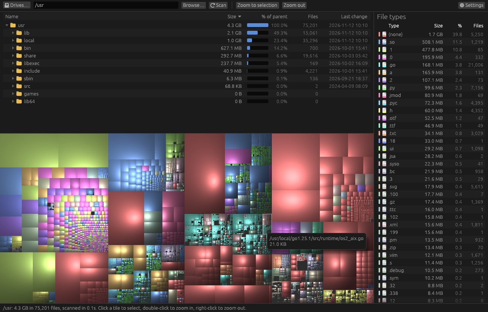

# dirmap

A WinDirStat-style disk usage visualizer written in Rust (egui/eframe).



- **Drive picker** listing every drive (or mounted volume on Linux/macOS) with total, free and used space,
  network drives included. Click one to scan the whole drive, e.g. `D:\`.
- **Live scan view**: folders and files appear as they are found, with running sizes, a progress bar
  (an estimate when scanning a whole drive), speed, and the folder being read.
- **Parallel scan** (rayon) that never follows symlinks or junctions and, by default, stays on one drive.
- **Directory tree** with Explorer's own file icons on Windows, sortable Name / Size / Files / Last change
  columns and percentage bars. Only visible rows are drawn, so huge folders stay fast.
- **Right-click menu** on any file or folder in the tree, like WinDirStat's: Open, Copy Path, Select in
  Explorer (Finder / file manager), Open in Command Prompt or PowerShell (Terminal elsewhere), Refresh Selected,
  Properties, Compute Hash (SHA-256), Add to Exclusion Filter, Delete Permanently, Delete to Recycle Bin (Trash),
  Remove Empty Folders, Empty Folder and Move to. Deleting always asks first. The same keys work on the
  selection: Enter, Ctrl+C, Ctrl+E, Ctrl+P / Ctrl+S, F5, Alt+Enter, Ctrl+H, Del, Shift+Del, Ctrl+M.
  After a change only that item is read again, so the tree and map update without a full rescan.
- **File types list** with totals per extension. Click one to highlight those files in the treemap; right-click
  to list every file of that type, highlight it, copy the extension or add `*.ext` to the exclusion filter.
- **Cushion treemap** (van Wijk & van de Wetering, like WinDirStat) colored by file type, drawn on the GPU.
  Hovering shows the path, size and date in the status bar; click to select (the tree jumps to it).
  - **Smooth zoom towards the pointer**: the wheel (or trackpad pinch) zooms continuously and the spot under the
    pointer stays under it, so you can point at a tiny file and keep zooming until it fills the window.
    Drag to pan. `+` / `-` zoom too.
  - **Double-click** a tile to open its folder: the folder grows from its place to fill the map.
    **Right-click** (or Zoom out) goes up one level, animated. **Zoom to selection** frames the selected
    file or folder. **Back / Forward** (◀ ▶, Alt+Left / Alt+Right or the mouse's side buttons) step through
    places you've looked at; **Whole map** (Home) returns to the full scan.
  - A soft light follows the pointer across the tiles, the hovered tile lifts slightly, and a faint bevel
    separates neighbours. Settings > Treemap turns these on or off and sets zoom sensitivity and animation speed.
  - File names and sizes fade in on tiles that have room for them (can be turned off).
  - Only the tiles in view are generated, down to about a pixel, on a background thread, so it stays smooth with
    millions of files.
- **Filters** by kind (audio, video, images, AI model weights such as gguf / safetensors / pt / onnx,
  archives, documents, code, programs, disk images), by size (larger than / smaller than a size such as
  `500 MB` or `2 GB`) and by name (**Custom**, below), with a count of how many files and bytes match. Two modes:
  - **Highlight** (default) keeps the layout and dims everything that doesn't match, on the treemap, the
    sunburst and the folder list, so you can see where the matches are.
  - **Show matches only** rebuilds the treemap, sunburst, folder list and File types tab from the matching
    files and the folders holding them. Switching back keeps your place.
- **Custom filter** (Show: **Custom**, or Ctrl+F / ⌘F): type a pattern and the maps update as you type.
  The ⏷ menu has examples, recent filters, saved presets, case-sensitive and match-all options, and the full
  syntax; extensions found in the scan autocomplete (Tab).

  | Pattern | Matches |
  |---|---|
  | `exr`, `.exr`, `*.exr` | files ending in .exr |
  | `*.exr, *.tx, *.tif` | any of several patterns (comma-separated) |
  | `*.exr, !*preview*` | EXR files, leaving out names containing preview |
  | `render_*`, `*diffuse*` | `*` is any run of characters |
  | `shot_????.exr` | `?` is exactly one character |
  | `shot_####.exr` | `#` is one digit: exactly four digits here |
  | `render.{frame}.exr` | a frame number of any length |
  | `render.{frame:04}.exr` | exactly four digits |
  | `render.{frame:1001-1100}.exr` | frames 1001–1100 at any padding (`1050`, `001050`) |
  | `render.{frame:1001-1100:04}.exr` | frames 1001–1100 written with four digits |
  | `shot_[1001-1100].exr` | short for `shot_{frame:1001-1100}.exr` |

  A frame number always covers a whole run of digits, so `render.####.exr` doesn't match `render.00001.exr`.
  Brackets are a range only around two whole numbers (`[1001-1100]`) and braces are special only as
  `{frame…}`, so names like `[draft] notes.txt` or `[2024-05-01].txt` need no escaping; put `\` before any
  other special character to match it literally (`\#`, `\*`, `\,`). Mistakes such as `[1100-1001]` are
  explained under the box. Filtering runs on the scan already in memory, in the background, so changing it
  never rescans.
- **Image sequences** (Sequences tab): finds numbered file sequences such as `shot010_comp.1001.exr …
  shot010_comp.1100.exr` and lists each once (`shot010_comp.####.exr`) with its frame count, range, missing
  frames, total and average size. Click one to filter the map to it. Only files in the same folder with the
  number right before the extension and everything else identical are grouped.
- **Sunburst view**: a ring chart of the same data, each ring one folder level deeper. Click to select,
  double-click or wheel to zoom, click the middle to go up.
- **Color by type, age or change**: age runs from red (changed today) to blue (10+ years old); change shows
  new, grown and shrunk files since a snapshot.
- **Size histogram** (Sizes tab): how many files and how much space fall in each size range. Click a bar to
  show only that range on the map.
- **Compare with a snapshot** (Changes tab): save a scan, scan again later, and see what is new, deleted, grew
  or shrank. `dirmap --cli PATH --save-snapshot FILE` saves one from a script; `dirmap --compare FILE PATH`
  opens the GUI comparing against it.
- **Duplicate finder** (Duplicates tab): files with identical contents, matched by size, then the first 64 KB,
  then the whole file, with how much space removing the extra copies would free.
- **Run as administrator** (Windows): the first time it starts without admin rights it asks whether to
  restart as administrator (always, just this once, or never), so system and other users' folders can be read.
  Change it later under Settings > Advanced.
- **Settings** (saved between runs): theme, size units, filters (folders and file patterns to skip or include,
  minimum size, maximum age), tree columns, treemap look with live preview, hidden files, scanner threads.

## Help and documentation

The full manual is built into dirmap: press **F1** for help on whatever is under the pointer, or
use the **❓ Help** menu for the Help Centre, Getting Started, keyboard shortcuts, mouse controls,
filter examples and troubleshooting. It works offline and always matches the version you have.

The same pages are plain Markdown in [`docs/src`](docs/src) (start at
[the Help Centre](docs/src/index.md)), and every CI run builds them into a website with
[mdBook](https://rust-lang.github.io/mdBook/) (the **dirmap-manual** artifact). `cargo test`
checks that the manual still matches the program: links, screenshots, every setting, every
shortcut and every filter example. See [How the help is built](docs/src/advanced/architecture.md#the-help-system).

## Download

Every push to `main` builds Windows, Linux and macOS versions on GitHub Actions (the **build**
workflow; open a run and download from *Artifacts*). Pushing a tag such as `v0.2.0` also attaches them
to a GitHub release.

- **Windows**: `dirmap-windows-x64.zip` contains `dirmap.exe`. No install needed.
- **Linux**: `dirmap-linux-x64.tar.gz` contains the `dirmap` binary and a `dirmap.desktop` launcher
  (copy it to `~/.local/share/applications/`). Needs X11 or Wayland plus `libxkbcommon-x11`, which
  desktop installs already have.
- **macOS** (11 Big Sur or later, Apple silicon and Intel): `dirmap-macos-universal.zip` contains
  `dirmap.app`. It isn't notarized, so the first time, right-click it and choose **Open**, or run
  `xattr -dr com.apple.quarantine dirmap.app`. To scan your whole disk including other apps' data,
  give it **Full Disk Access** in System Settings > Privacy & Security; without it those folders are
  counted as unreadable.

## Build from source

Install Rust from https://rustup.rs (1.95 or newer), then:

```sh
git clone https://github.com/PlotTwistDev/dirmap
cd dirmap
cargo run --release -- /path/to/scan        # GUI
cargo run --release -- --cli --top 20 ~/    # text report, no window
```

The binary ends up in `target/release/`. The same commands work on Windows, Linux and macOS.

Flags: `--all-fs` descends into other mounted filesystems, `--top N` sets the CLI row count,
`--save-snapshot FILE` (with `--cli`) saves the scan for comparing later, `--compare FILE` opens the GUI
comparing against a saved snapshot.

The GUI uses the GPU (wgpu) and falls back to OpenGL automatically. On macOS, scanning `/` covers the
system and data volumes together (they are one disk in Finder) without counting anything twice.
