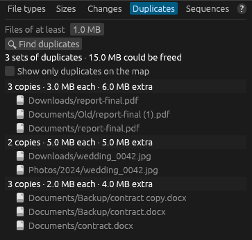

# Duplicate files

The **Duplicates** tab finds files whose **contents are identical**, wherever they are in the
scan and whatever they're called, and shows how much space the extra copies use.

## How to find duplicates

1. Scan a drive or folder.
2. Open the **Duplicates** tab on the right.
3. Set **Files of at least** to the smallest file worth checking (1 MB by default). Smaller
   files rarely free much space and take longest to compare.
4. Press **🔍 Find duplicates**. A progress bar shows how much has been read; **Cancel** stops it.

## How detection works

dirmap compares files in three rounds, so it only reads what it has to:

1. **Size.** Only files that have exactly the same size as at least one other file can be
   duplicates. This needs no reading at all and rules out most files.
2. **The first 64 KB.** For files of the same size, dirmap reads the first 64 KB and computes a
   fingerprint (a 64-bit hash). Files whose beginnings differ are ruled out.
3. **The whole file.** Files that are still alike and bigger than 64 KB are read completely and
   fingerprinted again. Files that match here are reported as duplicates.

Reading happens on several threads at once. Files that can't be opened are left out.

### How certain is the match?

dirmap matches files by **size plus a 64-bit fingerprint of their entire contents**. Two different
files of the same size having the same fingerprint is astronomically unlikely in practice, but it
isn't a byte-by-byte comparison, and the fingerprint isn't cryptographic. If you need certainty,
right-click each copy in the file manager and choose **Compute Hash (SHA-256)**: identical
SHA-256 hashes mean identical files.

## Reading the results

The heading shows how many **sets of duplicates** were found and how much space **could be
freed** by keeping one copy of each. Below it, each set has a header line:

`3 copies · 1.2 GB each · 2.4 GB extra`

followed by the copies' paths (relative to the scan). Sets are sorted by how much space their
extra copies use. Hover over a path to see it in full; click it to select that copy in the folder
list and on the map.

**Show only duplicates on the map** darkens everything that isn't a duplicate, so you can see
where the copies are.

## Managing duplicates safely

dirmap never deletes duplicates by itself. To remove a copy, click it in the list, then use the
right-click menu in the file manager (or press **Delete** to send it to the Recycle Bin or Trash).

Before deleting:

- **Hard links aren't copies.** Two names for the same file on disk look like duplicates to
  dirmap but deleting one frees nothing. This is common in `C:\Windows\WinSxS` and in some
  backup folders. Don't delete system files.
- **Programs expect their own files.** Two apps shipping the same library file both need their
  copy. Duplicates inside `Program Files`, game folders, `node_modules` or virtual environments
  are usually best left alone.
- **Cloud-synced folders** may show copies that only exist online.
- **Prefer the Recycle Bin** over **Delete Permanently** so you can undo a mistake.
- The list is a snapshot: it's cleared when you scan again or change files with a right-click
  command. Run the search again afterwards.

## Limitations

- Only files at or above the minimum size are compared. Empty (0-byte) files are never
  reported.
- Files are compared by contents only; names and dates don't matter.
- The search uses the scan in memory to know what to read, so files changed since the scan may
  be compared as they are now.
- Very large sets of same-size files (for example millions of 1 MB render tiles) take a while,
  because their first 64 KB has to be read.

## Related topics

- [Find duplicate files](../tutorials/duplicates.md)
- [Right-click menus and file operations](file-operations.md)
- [How sizes are calculated](../disk-usage/sizes.md)
