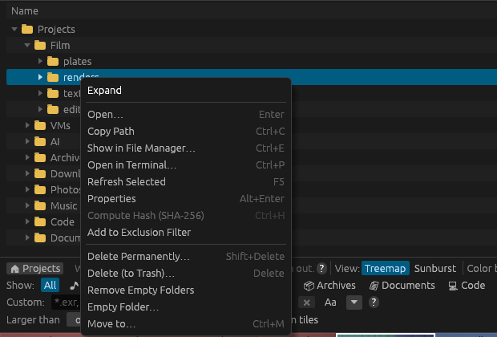

# Right-click menus and file operations

## The folder list's right-click menu

Right-click any file or folder in the folder list to select it and open this menu. Most commands
also have a keyboard shortcut, which works on the selected item wherever it was selected (in the
folder list, on the map, or in another tab), as long as you're not typing in a text box.

| Command | Shortcut | What it does |
|---|---|---|
| **Expand** / **Collapse** | | Opens or closes the folder in the list (folders only). |
| **Open…** | **Enter** | Opens the file with its usual app, or the folder in Explorer, Finder or your file manager. |
| **Copy Path** | **Ctrl+C** (or **Ctrl+Insert**) | Copies the full path to the clipboard. |
| **Select in Explorer…** (**Show in Finder…** / **Show in File Manager…**) | **Ctrl+E** | Opens the containing folder with the item selected. |
| **Open in Command Prompt…** | **Ctrl+P** | Windows: opens a Command Prompt in the folder (for a file, in its folder). |
| **Open in PowerShell…** | **Ctrl+S** | Windows: opens PowerShell in the folder. |
| **Open in Terminal…** | **Ctrl+P** | macOS and Linux: opens a terminal in the folder. On Linux, set `$TERMINAL` to choose which one. |
| **Refresh Selected** | **F5** | Reads the item from disk again and updates the tree and map. On the top item, rescans everything. |
| **Properties** | **Alt+Enter** | Windows: the Explorer Properties dialog. Elsewhere: dirmap's own window with size, file count, dates, permissions and whether it's read-only. |
| **Compute Hash (SHA-256)** | **Ctrl+H** | Files only. Reads the file and shows its SHA-256 hash with a **Copy** button. Closing the window cancels it. |
| **Add to Exclusion Filter** | | Adds the folder (or the file's name) to the scan exclusions, for the next scan. See [Scan exclusions](../filtering/scan-filters.md). |
| **Delete Permanently…** | **Shift+Delete** | Deletes the item for good after asking. It does **not** go to the Recycle Bin or Trash. |
| **Delete (to Recycle Bin)…** (**to Trash** on macOS and Linux) | **Delete** | Moves the item to the Recycle Bin or Trash after asking. |
| **Remove Empty Folders** | | Folders only. Deletes every folder inside it that is empty, including folders that only contain empty folders. The folder itself stays. |
| **Empty Folder…** | | Folders only. Deletes **everything inside** the folder for good after asking, keeping the folder itself. Not available for a whole drive. |
| **Move to…** | **Ctrl+M** | Moves the item into a folder you pick. Moving to another drive copies it and then deletes the original. |

On a Mac, use **⌘** instead of **Ctrl**.

### Safety rules

- **Delete Permanently**, **Delete (to Recycle Bin)** and **Empty Folder** always show what will be
  deleted (path, size and number of files) and wait for you to confirm. **Escape** or **Cancel**
  backs out.
- The top item of the scan can't be deleted or moved from dirmap, and a whole drive can't be
  emptied.
- **Remove Empty Folders** doesn't ask first, because it only removes folders with nothing in them.
- Only one file operation runs at a time; while one is running, the commands that change files
  are greyed out. Its progress shows in the status bar.
- Deleting skips links rather than following them, so it never deletes anything outside the item
  you chose.
- Be careful with keyboard shortcuts after clicking the map: **Delete** acts on whatever is
  selected, including a file you just clicked on the treemap. It still asks before doing anything.

### Platform notes

- **Windows:** the Recycle Bin is used exactly as Explorer would. If part of a folder is in use or
  protected, dirmap reports that some of it couldn't be moved.
- **macOS:** items go to the Trash through Finder, so Finder's **Put Back** works.
- **Linux:** moving to the Trash uses `gio trash`, KDE's `kioclient` or `trash-put` (trash-cli),
  whichever is installed. If none is available nothing is deleted and dirmap says so.
- **Delete Permanently** clears the read-only flag on files that have it.
- **Move to…** won't replace anything: if an item with the same name is already in the
  destination, it stops and says so. It also refuses to move a folder into itself.

### After a change

Only the items affected are read again, so the folder list, the map and the totals update without
a full rescan. Your selection, open folders and place on the map are kept. Results that depended
on the old state, such as the duplicate list and found sequences, are cleared; run them again if
you need them. The status bar reports the result (for example **Removed 3 empty folders.**) or the
problem if something failed; click **✖** to dismiss it.

## The File types list's right-click menu

| Command | What it does |
|---|---|
| **🔍 Find all .ext files** | Lists every file of that type in the scan, largest first, with the total. Click one to select it. |
| **Highlight in Map** / **Clear Highlight** | The same as clicking the row. |
| **Copy Extension** | Copies `.ext` to the clipboard. |
| **Add to Exclusion Filter** | Adds `*.ext` to the scan exclusions, for the next scan. |

## The map

The treemap and sunburst have no right-click menu: a right-click there zooms out. Select an item on
the map and use the keyboard shortcuts above, or find it in the folder list (it's selected there
too) and right-click it.

## Related topics

- [Keyboard shortcuts](../reference/keyboard.md)
- [The directory tree](../views/directory-tree.md)
- [Duplicate files](duplicates.md)
