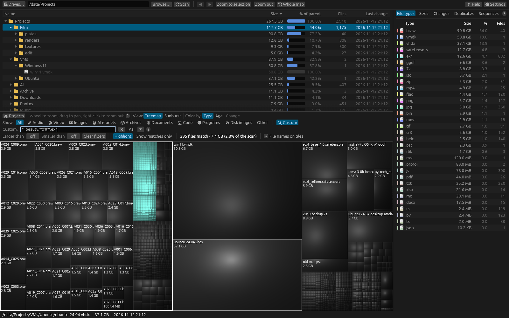
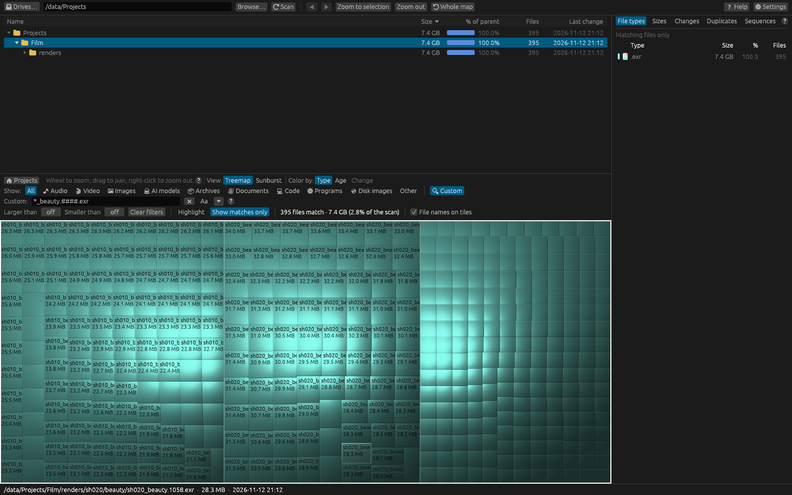

# Filtering overview

Filters change **which files the map shows**, without scanning again. They work on the scan
already in memory, in the background, so even on millions of files the map updates within a
moment of a change.

## The parts of a filter

All of these are in the filter bar under the file manager:

| Control | Keeps files that… |
|---|---|
| **Show:** category buttons (🎵 Audio, 🎬 Video, 🖼 Images…) | …are of **any** of the chosen kinds. **All** turns the categories off. See [File categories](categories.md). |
| **🔍 Custom** (or **Ctrl+F**) | …match a name pattern such as `*.exr` or `render.####.exr`. See [Custom filter syntax](syntax.md). |
| **Larger than** | …are at least this size. |
| **Smaller than** | …are smaller than this size. |

When you use more than one, a file has to pass **all** of them: **Show: Video** with **Larger
than 1 GB** shows videos of 1 GB or more.

### Entering sizes

Drag a size box left or right, or click it and type a size such as `500 MB`, `2 GB`, `100 KB` or
`1.5 TB`. A number on its own means megabytes. `0` (shown as **off**) turns the limit off. Units
follow the **Sizes** setting (binary or decimal).

The **Sizes** tab's histogram is a quick way to set both limits: click a bar to show only that
size range, and click it again to stop.

## Highlight or Show matches only

When any filter is on, two buttons choose how the result is shown:

| Mode | What you see |
|---|---|
| **Highlight** (default) | The map keeps its layout. Matching files keep their colours; everything else is hidden, leaving empty dark background in its place. Matches too small to see on their own still show as small square markers in the matches' colour. Each marker stands for all the tiny matches in a small area, so a dense cluster doesn't turn into confetti, and it stays until you zoom in far enough to see the files as tiles. On the sunburst and in the file manager, folders without any matches are shown faintly too. Best for seeing **where** matches are. |
| **Show matches only** | The map, the file manager and the File types list are rebuilt from the matching files and the folders that hold them, so the matches fill the map. Best when matches are a small part of the scan. |

Switching between the two keeps your place: the folder you're in, the selection and the folders
you've opened stay as they were (as long as they hold matches). In **Show matches only** the
status bar says how many matching files are shown, and the map says **No files match the
filter** if there are none.

## The match count

Next to the mode buttons, dirmap shows how many files match and how much space they use, for
example **1,204 files match · 82.1 GB (12.4% of the scan)**. While it's working this out you'll
see **Counting…** (or **Filtering…** while it rebuilds the map). **No files match** appears in
orange when nothing matches.

## Clearing filters

**Clear filters** (shown when a filter is on) turns off every filter: categories, sizes and the
Custom pattern. The **✖** next to the Custom box clears just the pattern.

## What filters don't change

- The scan itself. To leave files out of the scan, or out of the totals, use
  [Scan exclusions](scan-filters.md) instead.
- The **Duplicates** and **Sequences** searches, which always look at the whole scan.
- The **Changes** list, and **Find all .ext files** lists.
- The **Sizes** histogram follows the **Show:** categories only.

## What is remembered

Filters stay on when you scan another folder, but start empty the next time you open dirmap.
The **Highlight** / **Show matches only** choice, the Custom filter's options, recent patterns
and presets are remembered between runs.

## Other ways to make files stand out

- Click an extension in the **File types** list to highlight just that type.
- **Show only duplicates on the map** in the Duplicates tab.
- **Color by: Age** to see old and new files.

## Related topics

- [Custom filter syntax](syntax.md)
- [Filter examples](examples.md)
- [Filter the map but keep its layout](../tutorials/filter-keep-layout.md)
- [Filtering returns no results](../troubleshooting/index.md#filtering-returns-no-results)
