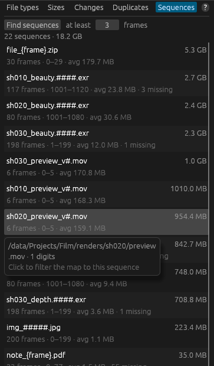

# Numbered sequences

Rendered images, simulation caches and scanned film are often saved as one file per frame:
`shot010_comp.1001.exr`, `shot010_comp.1002.exr`, and so on. Thousands of frames make the folder
list hard to read. The **Sequences** tab gathers them into one line per sequence.

## Finding sequences

1. Open the **Sequences** tab on the right (or choose **Find image sequences…** from the Custom
   filter's **⏷** menu).
2. Set **at least N frames** (3 by default): shorter runs of numbered files are ignored.
3. Press **Find sequences**. The search runs in the background on the scan in memory; **Cancel**
   stops it.

Each sequence is shown once, largest first, for example:

| Shown | Meaning |
|---|---|
| `shot010_comp.####.exr` | The name, with `#` for each digit of the frame number (or `{frame}` when the numbers aren't padded). |
| `100 frames · 1001–1100 · avg 31.2 MB` | How many frames there are, the first and last frame number, and the average frame size. A step is shown if frames go up by more than one (`1001–1199 by 2`). |
| `3 missing` | How many frame numbers are missing between the first and last frame. |
| Size on the right | Total size of the sequence. |

Hover over a sequence to see its folder, its extension and padding, and exactly which frames are
missing (the first 20 gaps).

**Click a sequence** to filter the map to it: dirmap puts a matching pattern in the Custom
filter (for example `shot010_comp.####.exr`) and selects the folder that holds it. Use
**Show matches only** to see just that sequence.

## How dirmap decides what a sequence is

So that unrelated numbered files aren't lumped together, a sequence must:

- be in **one folder** (the same name in two folders is two sequences);
- have the frame number as the **last run of digits, right before the extension**
  (`name.1001.exr`, `name_1001.exr` or `name1001.exr`), with **everything else identical**. So
  `shot010_v1.1001.exr` and `shot010_v2.1001.exr` are two sequences, and `rock_12_diffuse.tif` is
  not a frame at all;
- have an extension of up to 10 letters and digits, or no extension at all;
- use the **same padding**: `a.0001.exr` and `a.00001.exr` are separate sequences. Unpadded
  numbers of different lengths (`a.9.png`, `a.10.png`) are one sequence;
- have **at least** the minimum number of frames;
- be **reasonably dense**: the frame numbers must cover at least a quarter of their range, and
  the step between frame numbers can't be more than 100. This keeps out photos named by timestamp or ID numbers.

Frames rendered "on twos" (1001, 1003, 1005…) are recognised with a step of 2, and only frames
missing on that step count as missing.

## Using the frame-number filter directly

You don't need the Sequences tab to filter by frame number: the Custom filter understands
`####`, `{frame}` and frame ranges. See [Frame numbers and padding](syntax.md#frame-numbers-and-padding).

## Limitations

- Sequences are found on request, not automatically, and the results are cleared when you scan
  again or change files with a right-click command.
- The file manager and treemap still show each frame as its own file.
- Files whose frame number isn't the last number in the name (`shot_1001_beauty.exr`) aren't
  recognised as sequences, though the Custom filter can still match them (`shot_####_beauty.exr`).

## Related topics

- [Locate an image or render sequence](../tutorials/render-sequence.md)
- [Render farms and VFX projects](../advanced/vfx.md)
- [Custom filter syntax](syntax.md)
