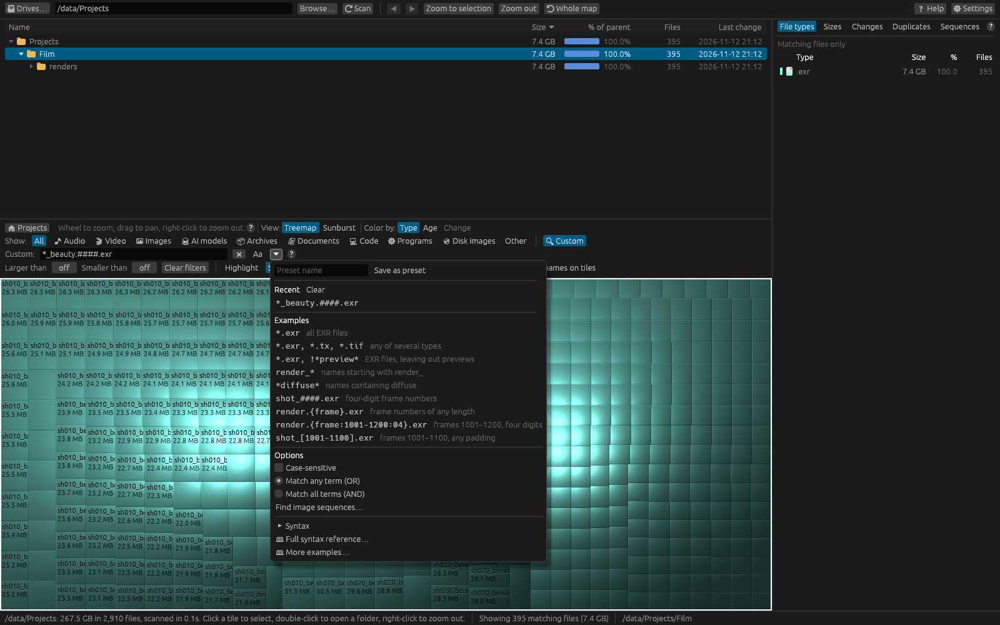

# Custom filter syntax

The **🔍 Custom** filter limits the map to files whose **names** match a pattern. Open it by
clicking **🔍 Custom** at the end of the **Show:** row, or press **Ctrl+F** (**⌘F** on a Mac).
Type a pattern; the map updates as you type.



Every example on this page is checked automatically against dirmap's pattern matcher, so they
behave exactly as shown.

## The basics

- A pattern is matched against each **file name**, not its folder or full path. Folders are never
  matched themselves; they're shown when they contain matching files.
- Matching **ignores upper and lower case** unless you press **Aa** (case-sensitive).
- Separate several patterns with **commas**. A file matches if it matches **any** of them.
- Start a pattern with **!** to **leave out** what it matches.

## Extensions

A single word, with or without a dot or `*.`, means "names ending in that extension".

| Pattern | Matches | Doesn't match |
|---|---|---|
| `exr` | `beauty.0001.exr`, `BEAUTY.EXR` | `beauty.exr.bak`, `exrfile.png` |
| `.exr` | `beauty.0001.exr` | `notexr` |
| `*.exr` | `beauty.0001.exr` | `beauty.exr.bak` |
| `*.tar.gz` | `src.tar.gz` | `src.gz` |
| `makefile` | `Makefile`, `build.makefile` | `Makefile.bak` |

A bare word (without a dot) also matches a file with exactly that name, so `makefile` finds
`Makefile` and `readme` finds `README`.

## Wildcards

| Symbol | Means |
|---|---|
| `*` | Any run of characters, including none. |
| `?` | Exactly one character. |

| Pattern | Matches | Doesn't match |
|---|---|---|
| `render_*` | `render_beauty.exr` | `xrender_beauty.exr` |
| `*diffuse*` | `rock_diffuse_4k.png`, `ROCK_DIFFUSE.tif` | `rock_albedo.png` |
| `shot_????.exr` | `shot_ab12.exr` | `shot_abc.exr`, `shot_abcde.exr` |
| `shot_*.exr` | `shot_.exr`, `shot_0042_v2.exr` | `shot.exr` |
| `caf?.txt` | `café.txt` | `cafe_.txt` |

`?` counts characters, not bytes, so it matches one accented letter too.

## Several patterns and exclusions

| Pattern | Matches | Doesn't match |
|---|---|---|
| `*.exr, *.tx, *.tif` | `a.exr`, `b.TX`, `c.tif` | `d.tiff` |
| `*.exr, !*preview*` | `beauty.1001.exr` | `beauty_preview.1001.exr`, `beauty.1001.png` |
| `!*.tmp, !~$*` | `report.docx` | `a.TMP`, `~$report.docx` |
| `*.mov, *.mp4, !*proxy*` | `edit_v3.mov`, `clip.mp4` | `clip_proxy.mp4` |

A pattern with only **!** terms shows everything except what they match.

### Match all terms (AND)

In the **⏷** menu, **Match all terms (AND)** makes a file match only if it matches **every**
pattern, instead of any one. **!** patterns still leave files out.

| Pattern (match all) | Matches | Doesn't match |
|---|---|---|
| `*.exr, *beauty*` | `shot_beauty.1001.exr` | `shot_depth.1001.exr`, `shot_beauty.1001.png` |
| `*.exr, *beauty*, !*preview*` | `shot_beauty.1001.exr` | `shot_beauty_preview.1001.exr` |

### Case-sensitive matching

Press **Aa** next to the box (or tick **Case-sensitive** in the **⏷** menu).

| Pattern (case-sensitive) | Matches | Doesn't match |
|---|---|---|
| `*Diffuse*` | `rock_Diffuse.tif` | `rock_diffuse.tif` |
| `exr` | `a.exr` | `a.EXR` |

## Frame numbers and padding

For numbered files such as rendered frames, dirmap has symbols that match **a whole number**:

| Symbol | Means |
|---|---|
| `#` | One digit. `####` is a number of **exactly four digits** (`0001` to `9999`). |
| `{frame}` | A number with **any** number of digits. |
| `{frame:04}` | A number of **exactly 4 digits** (any width from 1 to 18). |
| `{frame:1001-1100}` | A number **from 1001 to 1100**, written with any padding (`1050` or `001050`). |
| `{frame:1001-1100:04}` | From 1001 to 1100 **and** exactly 4 digits. |
| `[1001-1100]` | Short for `{frame:1001-1100}`. |

| Pattern | Matches | Doesn't match |
|---|---|---|
| `shot_####.exr` | `shot_1001.exr`, `shot_0001.exr` | `shot_001.exr`, `shot_00001.exr`, `shot_abcd.exr` |
| `render.{frame}.exr` | `render.7.exr`, `render.001001.exr` | `render..exr`, `render.v2.exr` |
| `render.{frame:04}.exr` | `render.1001.exr`, `render.0002.exr` | `render.10001.exr`, `render.2.exr` |
| `render.{frame:1001-1100}.exr` | `render.1001.exr`, `render.1100.exr`, `render.001050.exr` | `render.1000.exr`, `render.1101.exr` |
| `render.{frame:1001-1100:04}.exr` | `render.1050.exr` | `render.001050.exr` |
| `shot_[1001-1100].exr` | `shot_1001.exr`, `shot_1100.exr` | `shot_999.exr`, `shot_1101.exr` |
| `*.[1001-1100].exr` | `shot010_v002.1050.exr` | `shot010_v002.0050.exr` |
| `shot###_comp_v##.{frame:1001-1003}.exr` | `shot010_comp_v02.1002.exr` | `shot10_comp_v02.1002.exr`, `shot010_comp_v02.1004.exr` |

### A frame number always takes the whole run of digits

`####` means "a number that is four digits long", not "four digits somewhere". So
`render.####.exr` doesn't match `render.00001.exr`: the number there has five digits.

| Pattern | Matches | Doesn't match |
|---|---|---|
| `render.####.exr` | `render.0100.exr` | `render.00001.exr`, `render.001001.exr` |
| `*_####.exr` | `v12_2345.exr` | `v12_12345.exr` |

For the same reason a frame symbol can't sit right next to a digit or another frame symbol
(`v1####` or `{frame}{frame}`): dirmap explains the problem under the box instead.

## Brackets, braces and special characters

Square brackets are a range **only** when they hold two whole numbers joined by a dash, such as
`[1001-1100]`. Braces are special **only** as `{frame…}`. Everything else is an ordinary
character, so names like these need no special treatment:

| Pattern | Matches | Doesn't match |
|---|---|---|
| `[draft]*` | `[draft] notes.txt` | `draft notes.txt` |
| `[2024-05-01]*` | `[2024-05-01] notes.txt` | `2024-05-01 notes.txt` |
| `*[final]*` | `cut [final].mov` | `cut final.mov` |
| `{backup}*` | `{backup} 2024.zip` | `backup 2024.zip` |
| `*(1).jpg` | `IMG (1).jpg` | `IMG 1.jpg` |

To match a character that is otherwise special (`*`, `?`, `#`, `,`, `!` at the start, or a
`[1-2]` that should be read literally), put a backslash `\` before it:

| Pattern | Matches | Doesn't match |
|---|---|---|
| `track \#1.mp3` | `Track #1.mp3` | `Track 51.mp3` |
| `a\,b.txt` | `a,b.txt` | `a.txt` |
| `what\?.txt` | `what?.txt` | `whatx.txt` |
| `\!important.txt` | `!important.txt` | `important.txt` |
| `\[1-2].txt` | `[1-2].txt` | `1.txt` |

## Mistakes dirmap explains

If a pattern can't work, an orange **⚠** message under the box says why, and the last pattern that
worked stays in effect until you fix it.

| Pattern | Problem |
|---|---|
| `shot_[1100-1001].exr` | The range runs backwards; write it as `1001-1100`. |
| `{frame` | `{frame` has no closing `}`. |
| `{frame:abc}` | `abc` isn't a width (`04`) or a range (`1001-1100`). |
| `{frame:04:1001-1100}` | The range has to come before the width. |
| `{frame:1001-1100:03}` | 1001 doesn't fit in 3 digits. |
| `{frame:0}` | A width must be from 1 to 18 digits. |
| `v1####` | A frame number can't touch another digit. |
| `{frame}{frame}` | Two frame numbers can't touch. |
| `!` | `!` needs a pattern after it. |
| `*.exr, !` | `!` needs a pattern after it. |
| `abc\` | A `\` at the end has nothing to make literal. |

## While you type

- With the box empty, a list of **examples** appears under it. Click one to use it.
- While you type an extension (`*.ex`, `.ex` or `ex`), extensions found in the scan are offered,
  with how much space they use. Use **↑** and **↓** to choose and **Tab** (or a click) to complete.
- The map updates a moment after you stop typing. **Enter** applies the pattern straight away and
  adds it to **Recent** in the **⏷** menu.
- The **⏷** menu also has saved presets, recent patterns, examples, the matching options, a
  **Find image sequences…** shortcut and a short syntax summary. See
  [Presets and recent filters](presets.md).

## Quick reference

```text
exr  .exr  *.exr        files ending in .exr
*.exr, *.tx             either type (comma = or)
*.exr, !*preview*       EXR files, leaving out names containing preview
render_*  *diffuse*     * = any characters
shot_????.exr           ? = exactly one character
shot_####.exr           # = one digit: exactly four digits here
render.{frame}.exr      a frame number of any length
render.{frame:04}.exr   exactly four digits
render.{frame:1001-1100}.exr     frames 1001 to 1100, any padding
render.{frame:1001-1100:04}.exr  frames 1001 to 1100, four digits
shot_[1001-1100].exr    short for shot_{frame:1001-1100}.exr
track \#1.mp3           \ makes the next character literal
```

## Related topics

- [Filter examples](examples.md)
- [Numbered sequences](sequences.md)
- [Filtering overview](overview.md)
- [Presets and recent filters](presets.md)
