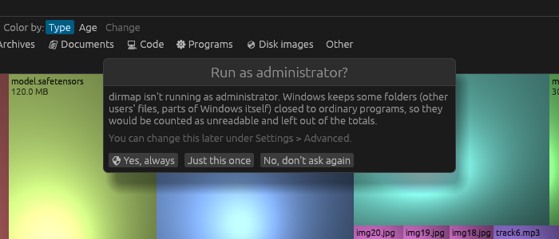

# Installation and first launch

Filescape is a single program file and nothing runs in the background. On Linux you can also
install it as a package, so it shows up in your application menu.

## Windows

1. Download `Filescape-windows.zip` and extract `Filescape.exe` anywhere, for example to your
   Desktop or `C:\Tools`.
2. Double-click `Filescape.exe`.
3. If Windows SmartScreen warns about an unrecognised app, choose **More info**, then **Run anyway**.

The first time it starts without administrator rights, Filescape asks whether to restart as
administrator:



| Choice | What happens |
|---|---|
| **🛡 Yes, always** | Restarts as administrator now, and every time from now on. Windows shows its usual permission prompt. |
| **Just this once** | Restarts as administrator now and asks again next time. |
| **No, don't ask again** | Carries on without administrator rights and never asks again. |

You can change this later under **⚙ Settings > Advanced**. See
[Running as administrator](../settings/administrator.md) for what difference it makes.

## Linux

Pick whichever suits your system. All of them need a 64-bit x86 system with glibc 2.35 or later
(Ubuntu 22.04, Debian 12, Fedora 36 or newer), running X11 or Wayland.

| Download | For | How |
|---|---|---|
| `Filescape-linux.AppImage` | Any distribution | Make it executable (`chmod +x Filescape-linux.AppImage`, or tick **Allow executing file as program** in its properties) and double-click it. |
| `Filescape-linux.deb` | Ubuntu, Debian, Linux Mint, Pop!_OS | Double-click it, or run `sudo apt install ./Filescape-linux.deb`. |
| `Filescape-linux.rpm` | Fedora, RHEL, openSUSE | Double-click it, or run `sudo dnf install ./Filescape-linux.rpm` (`sudo zypper install` on openSUSE). |
| `Filescape-linux.tar.gz` | Any distribution | Extract it (`tar xzf Filescape-linux.tar.gz`) and run `./filescape/filescape`. |

The `.deb` and `.rpm` add Filescape to your application menu and put `filescape` on your path, so
you can also start it from a terminal with a folder to scan: `filescape ~/Videos`. To remove it,
use `sudo apt remove filescape` or `sudo dnf remove filescape`.

With the `.tar.gz`, you can copy `filescape.desktop` to `~/.local/share/applications/` (edit its
`Exec=` line to point at the program) and `filescape.png` to `~/.local/share/icons/` so Filescape
appears in your application menu with its icon.

## macOS

1. Download `Filescape-macos.dmg`, open it and drag `Filescape.app` onto **Applications**.
2. Filescape isn't notarised by Apple, so the first time, **right-click** it and choose **Open**,
   then **Open** again. (Or run `xattr -dr com.apple.quarantine Filescape.app` in Terminal.)
3. To scan your whole disk including other apps' data, give Filescape **Full Disk Access** in
   **System Settings > Privacy & Security**. Without it, those folders are counted as unreadable.

## Building from source

With Rust 1.95 or newer installed from <https://rustup.rs>:

```sh
git clone https://github.com/PlotTwistDev/dirmap
cd Filescape
cargo run --release -- /path/to/scan
```

## The first launch

Filescape opens on the drive list. Pick a drive, or type a folder and press **Enter**. Everything
you change in **⚙ Settings** is remembered for next time. See [Quick Start](quick-start.md).

## Related topics

- [System requirements](system-requirements.md)
- [Running as administrator](../settings/administrator.md)
- [Command line](../reference/command-line.md)
