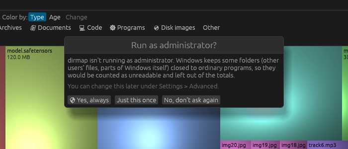

# Installation and first launch

dirmap is a single program file. There is nothing to install and nothing runs in the background.

## Windows

1. Download `dirmap-windows-x64.zip` and extract `dirmap.exe` anywhere, for example to your
   Desktop or `C:\Tools`.
2. Double-click `dirmap.exe`.
3. If Windows SmartScreen warns about an unrecognised app, choose **More info**, then **Run anyway**.

The first time it starts without administrator rights, dirmap asks whether to restart as
administrator:



| Choice | What happens |
|---|---|
| **🛡 Yes, always** | Restarts as administrator now, and every time from now on. Windows shows its usual permission prompt. |
| **Just this once** | Restarts as administrator now and asks again next time. |
| **No, don't ask again** | Carries on without administrator rights and never asks again. |

You can change this later under **⚙ Settings > Advanced**. See
[Running as administrator](../settings/administrator.md) for what difference it makes.

## Linux

1. Download `dirmap-linux-x64.tar.gz` and extract it: `tar xzf dirmap-linux-x64.tar.gz`.
2. Run `./dirmap/dirmap`.
3. Optionally copy `dirmap.desktop` to `~/.local/share/applications/` (edit its `Exec=` line to
   point at the program) so dirmap appears in your application menu.

## macOS

1. Download `dirmap-macos-universal.zip` and open it to get `dirmap.app`. Move it to
   **Applications** if you like.
2. dirmap isn't notarised by Apple, so the first time, **right-click** it and choose **Open**,
   then **Open** again. (Or run `xattr -dr com.apple.quarantine dirmap.app` in Terminal.)
3. To scan your whole disk including other apps' data, give dirmap **Full Disk Access** in
   **System Settings > Privacy & Security**. Without it, those folders are counted as unreadable.

## Building from source

With Rust 1.95 or newer installed from <https://rustup.rs>:

```sh
git clone https://github.com/PlotTwistDev/dirmap
cd dirmap
cargo run --release -- /path/to/scan
```

## The first launch

dirmap opens on the drive list. Pick a drive, or type a folder and press **Enter**. Everything
you change in **⚙ Settings** is remembered for next time. See [Quick Start](quick-start.md).

## Related topics

- [System requirements](system-requirements.md)
- [Running as administrator](../settings/administrator.md)
- [Command line](../reference/command-line.md)
