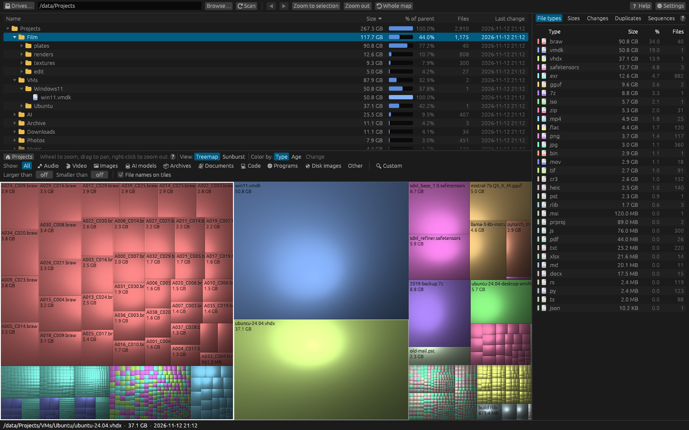

# Understanding the interface

Filescape has four workspaces, switched with the buttons at the left of the toolbar:

- **🗀 Files** (**Ctrl+1**) is a file manager for browsing your drives and folders without a
  scan. It's where Filescape starts. See [The Files workspace](../views/file-manager.md).
- **🖧 Remote** (**Ctrl+2**) puts this computer beside a server. See
  [The Remote workspace](../views/remote.md).
- **▦ Storage Analysis** (**Ctrl+3**) is the scan with its treemap, described on the rest of this
  page.
- **✨ AI Models** (**Ctrl+4**) lists the AI models on this computer. See
  [The AI Models workspace](../views/ai-models.md).

Storage Analysis has six parts, from top to bottom:

## Toolbar

| Control | What it does |
|---|---|
| **🗀 Files** / **▦ Storage Analysis** | Switch workspace. See [The Files workspace](../views/file-manager.md#workspaces). |
| **← →** | Back and Forward through the places you've looked at on the treemap. |
| **↑** | Up one level on the map. |
| **⌂** (Whole map) | Return to the whole scan. |
| **⌖** (Zoom to selection) | Bring the selected file or folder into view on the map. |
| Breadcrumb (*scan* / *folder* / …) | Which folder the map shows; click a part to go back to it. The last part opens the scan controls: **🖴 Drives…**, the folder box, **Browse…** and **⟳ Scan**. Before the first scan these sit on the toolbar itself. |
| **⟳** | Scan the same folder again. |
| **❓ Help** | This help: Help Centre, shortcuts, examples, troubleshooting and About. |
| **⚙ Settings** | Appearance, scan filters, columns, treemap look and advanced options. |

## File manager

A Finder- or Explorer-style file manager for the scan, with tabs, Back and Forward, a clickable
path and **List**, **Icons**, **Columns** and **Tree** layouts. Every item shows its size and
share of the folder, largest first. Double-click a folder to open it (the map follows), and use
the usual keys and the right-click menu to copy, move, rename and delete. The border under it can
be dragged to give it or the map more room. See [The file manager](../views/file-browser.md).

## Map toolbar

One row between the file manager and the map:

- **Treemap** / **Sunburst** switches the map. See [The sunburst](../views/sunburst.md).
- The **Size** menu (**On disk**, **Logical size**, and with cloud files **Cloud only** and
  **Reclaimable**) picks which size the map and totals use. See [Sizes](../disk-usage/sizes.md).
- **Colour** colours the map by **Type**, **Age** or **Change**. See [Colour modes](../views/color-modes.md).
- **Filters** opens the Filters panel: file types, where files are stored, size, when they last
  changed, and the options for name patterns. It shows how many filters are on. See
  [Filtering overview](../filtering/overview.md).
- The **search box** limits the map to names matching a pattern such as `*.psd`. See
  [Custom filter syntax](../filtering/syntax.md).
- **Display** has **File names on tiles**, **Previews on tiles**, the cloud marks and the
  **Preview pane**.

In a narrow window the Size and Colour menus (and then Display) move into a **⋯** menu at the
right end, so the row never wraps.

When filters are on, a second row shows each one as a chip: click a chip's **×** to remove that
filter, or **Clear all**. The row starts with **Highlight** / **Only matches** and ends with how
many files match and how much space they take. With no filter on, the row isn't there.

## The map

The treemap (or sunburst) fills the middle of the window. Hover to see what something is,
click to select, double-click to open a folder, wheel to zoom, drag to pan and right-click to
go back up. See [Navigating the treemap](../views/treemap-navigation.md).

## Side panel

Five tabs on the right, which can be made wider by dragging their left edge:

| Tab | What it shows |
|---|---|
| **File types** | Space used by each file extension. Click one to highlight it on the map. |
| **Sizes** | A histogram of file sizes. Click a bar to show only that size range. |
| **Changes** | Save a snapshot or compare with one. |
| **Duplicates** | Find files with identical contents. |
| **Sequences** | Find numbered image and render sequences. |

## Status bar

Along the bottom. It shows the scan's total size, file count and time, or, while the pointer is
over the map, the full path, size and date of what's under it. It also shows the selected item's
path, the result of the last file operation, and **Rescan** when scan settings have changed.

## Related topics

- [Quick Start](quick-start.md)
- [Interpreting scan results](results.md)
- [Keyboard shortcuts](../reference/keyboard.md)
