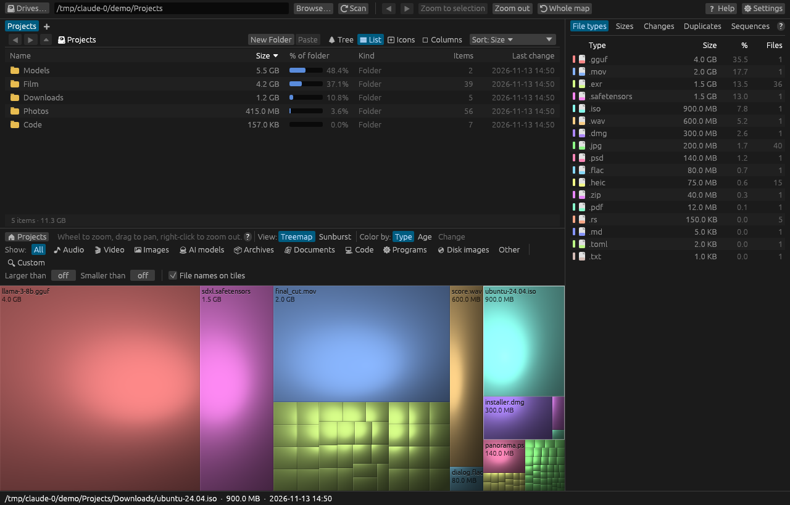

# Understanding the interface

The window has six parts, from top to bottom:

## Toolbar

| Control | What it does |
|---|---|
| **🖴 Drives…** | Shows the list of drives with their size and free space. Click one to scan it. |
| Folder box | The drive or folder to scan. Type a path and press **Enter**. |
| **Browse…** | Pick a folder with the system's folder picker, then scan it. |
| **⟳ Scan** | Scan the folder in the box (again). |
| **◀ ▶** | Back and Forward through the places you've looked at on the treemap. |
| **Zoom to selection** | Bring the selected file or folder into view on the map. |
| **Zoom out** | Go up one level on the map. |
| **⟲ Whole map** | Return to the whole scan. |
| **❓ Help** | This help: Help Centre, shortcuts, examples, troubleshooting and About. |
| **⚙ Settings** | Appearance, scan filters, columns, treemap look and advanced options. |

## File manager

A Finder- or Explorer-style file manager for the scan, with tabs, Back and Forward, a clickable
path and **List**, **Icons**, **Columns** and **Tree** layouts. Every item shows its size and
share of the folder, largest first. Double-click a folder to open it (the map follows), and use
the usual keys and the right-click menu to copy, move, rename and delete. The border under it can
be dragged to give it or the map more room. See [The file manager](../views/file-browser.md).

## Filter bar

Under the file manager:

- **Breadcrumbs** (🏠 *scan* › *folder* › …) show which folder the map is showing; click one to
  jump there.
- **View:** switches the map between **Treemap** and **Sunburst**.
- **Color by:** colours the map by **Type**, **Age** or **Change**. See [Colour modes](../views/color-modes.md).
- **Show:** limits the map to kinds of files (Audio, Video, Images…) or to a **🔍 Custom**
  name pattern.
- **Larger than** / **Smaller than** limit the map to a size range.
- **Highlight** / **Show matches only** choose how a filter is shown, and a count shows how many
  files match. See [Filtering overview](../filtering/overview.md).
- **File names on tiles** turns the names written on large rectangles on or off.

## The map

The treemap (or sunburst) fills the middle of the window. Hover to see what something is,
click to select, double-click to open a folder, wheel to zoom, drag to pan and right-click to
go back up. See [Navigating the treemap](../views/treemap-navigation.md).

## Side panel

Five tabs on the right, which can be made wider by dragging their left edge:

| Tab | What it shows |
|---|---|
| **File types** | Space used by each file extension. Click one to highlight it on the map. |
| **Sizes** | A histogram of file sizes. Click a bar to show only that size range. |
| **Changes** | Save a snapshot or compare with one. |
| **Duplicates** | Find files with identical contents. |
| **Sequences** | Find numbered image and render sequences. |

## Status bar

Along the bottom. It shows the scan's total size, file count and time, or, while the pointer is
over the map, the full path, size and date of what's under it. It also shows the selected item's
path, the result of the last file operation, and **Rescan** when scan settings have changed.

## Related topics

- [Quick Start](quick-start.md)
- [Interpreting scan results](results.md)
- [Keyboard shortcuts](../reference/keyboard.md)
