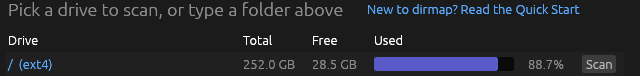
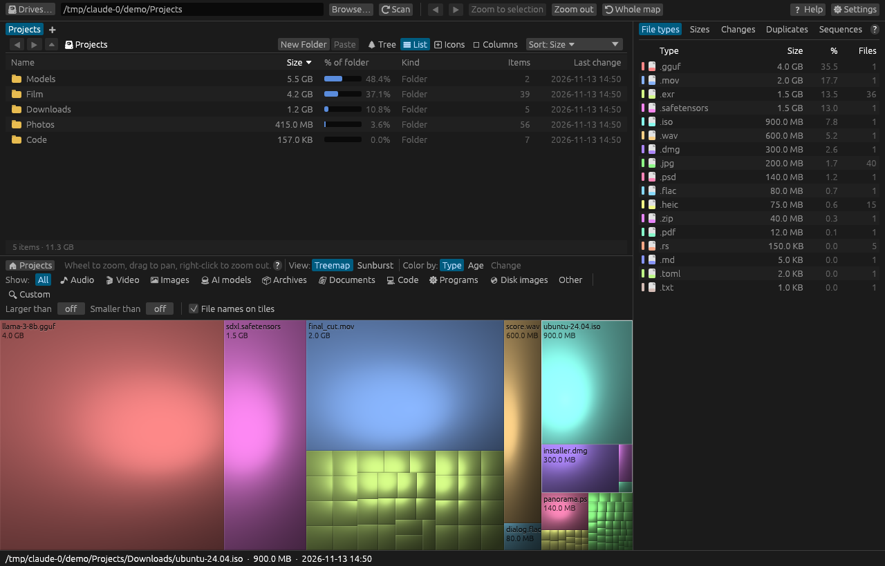

# Quick Start

This page gets you from opening dirmap to knowing what fills your drive in a couple of minutes.

## 1. Pick what to scan

When dirmap opens it lists your drives with their total, free and used space.

- Click a drive's name or its **Scan** button to scan the whole drive.
- Or type a folder into the box at the top (for example `D:\Projects` or `~/Videos`) and press
  **Enter** or **⟳ Scan**. **Browse…** picks a folder with the system's folder picker.

On Windows, dirmap may first ask whether to run as administrator. Say **Yes** if you want to
include folders that belong to Windows or to other users; see
[Running as administrator](../settings/administrator.md).

## 2. Watch the scan

Folders appear and grow while they are being read. For a whole drive the progress bar shows
roughly how far along the scan is. You can press **Cancel** at any time.

## 3. Read the result

- The **file manager** at the top lists what's in the scanned folder, largest first.
  Double-click a folder to open it; the map below zooms to it too.
- The **treemap** below shows every file as a rectangle. The bigger the rectangle, the bigger
  the file. Colours show the file type.
- The **File types** list on the right shows which extensions use the most space.

## 4. Find the biggest things

- Hover over a large rectangle: the status bar at the bottom shows its full path, size and date.
- Click it to select it. The file manager shows it, in the folder that holds it.
- Double-click to open the folder that holds it; right-click the map to go back up.
- Turn the mouse wheel over the map to zoom towards the pointer; drag to move around.

## 5. Do something about it

Right-click a file or folder in the file manager for **Open**, **Select in Explorer**,
**Delete (to Recycle Bin)**, **Move to…** and more. Deleting always asks first. See
[Right-click menus and file operations](../analysis/file-operations.md).

## Next steps

- [Understanding the interface](interface.md)
- [Navigating the treemap](../views/treemap-navigation.md)
- [Filtering overview](../filtering/overview.md)
- [Keyboard shortcuts](../reference/keyboard.md)
