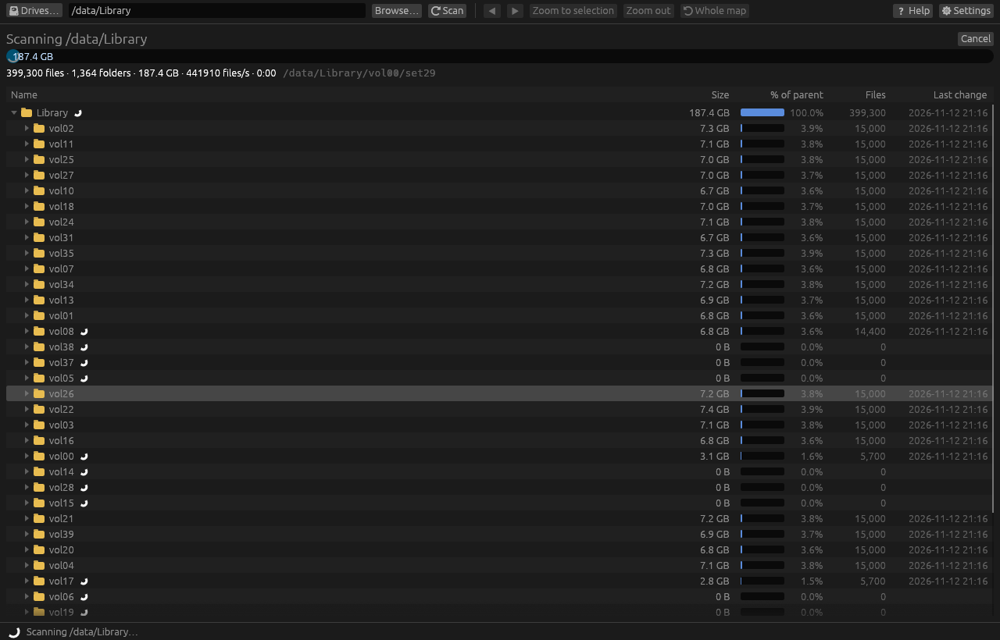

# Scanning a drive or folder

## Starting a scan

- **A whole drive:** click its name or **Scan** in the drive list. The list appears when dirmap
  starts, and from **🖴 Drives…** in the toolbar once a scan is open.
- **A folder:** type its path in the folder box and press **Enter** or **⟳ Scan**, or use
  **Browse…**.
- **From the command line:** `dirmap D:\Projects` opens dirmap and scans that folder straight
  away. See [Command line](../reference/command-line.md).

On Windows, typing just a drive letter such as `D:` scans the whole drive `D:\`.

The drive list shows each drive's total, free and used space. Network drives are marked
`[network]`. Drives that aren't ready (an empty card reader, a disconnected share) and CD/DVD
drives aren't listed, but you can still type their path.

## While it scans

- The progress bar shows **about N%** when you scan a whole drive, estimated from the drive's
  used space. For a folder it shows the total found so far.
- The line under it shows files, folders, total size, files per second, elapsed time and, if
  any, how many items couldn't be read.
- The folder being read right now is shown in grey.
- With **Show folders and files as they are found** turned on (the default, in
  **⚙ Settings > General**), the folder list fills in live: click a folder to open it while the
  scan carries on. A spinner marks folders still being read. Each open folder lists its 200
  largest files so far; the rest are summarised as "… and N smaller files".
- **Cancel** stops the scan and keeps whatever you had open before.

When the walk is done the bar shows **Sorting and building the map…** for a moment, then the
result appears.

## Scanning again

Press **⟳ Scan** to scan the same folder again. To refresh just one folder after you've changed
things on disk, select it in the folder list and press **F5** (**Refresh Selected**): only that
folder is read again. Refreshing the top item of the scan rescans everything.

If you change a setting that affects what a scan finds (for example the scan exclusions), the
status bar shows **Scan settings changed. Rescan**; click **Rescan** to apply it.

## What gets counted

- Every file the scan can read, at its full size. See [How sizes are calculated](../disk-usage/sizes.md).
- Symbolic links and junctions are **never followed**, so nothing is counted twice through a
  link. See [Links, junctions and mounted drives](../disk-usage/links-and-mounts.md).
- On Linux and macOS, other drives mounted inside the scanned folder are skipped unless you turn
  off **Stay on the scanned drive** (Settings > Advanced) or start dirmap with `--all-fs`.
- Folders and files you've excluded under **⚙ Settings > Filtering**. See
  [Scan exclusions](../filtering/scan-filters.md).
- Folders the scan isn't allowed to read are counted as **unreadable** and left out. See
  [Hidden, system and unreadable files](../disk-usage/hidden-and-unreadable.md).

## Related topics

- [Interpreting scan results](results.md)
- [Scanning millions of files](../advanced/millions-of-files.md)
- [External and network drives](../advanced/network-drives.md)
