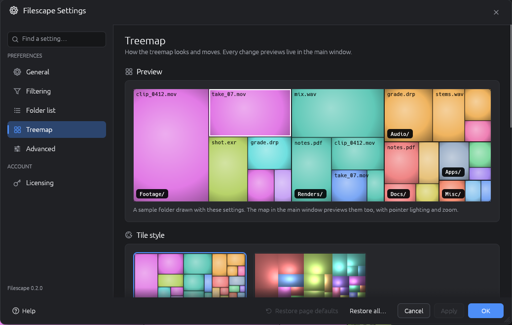
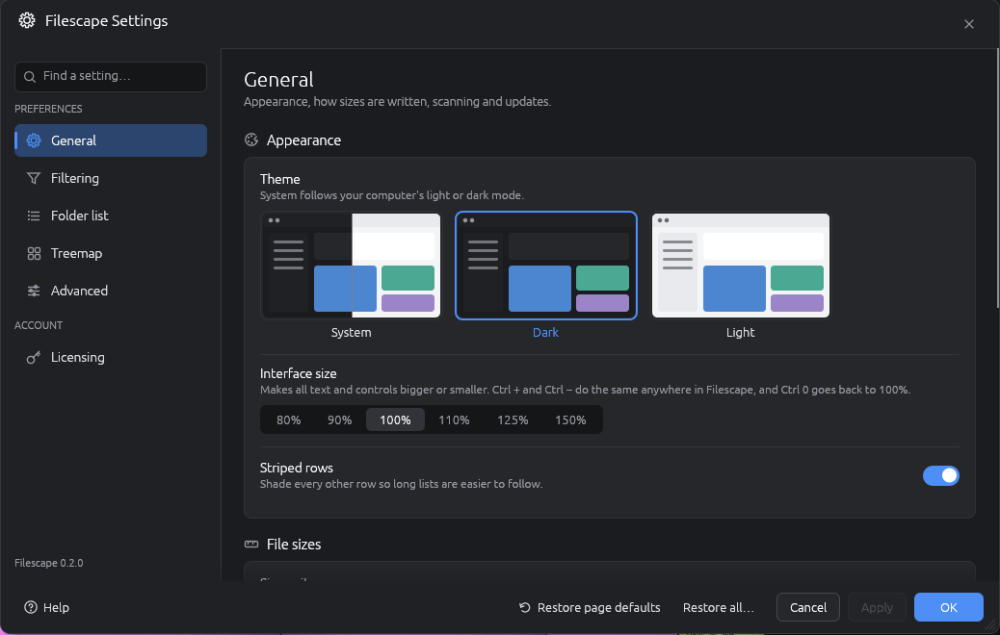

# Settings reference

Open **⚙ Settings** at the right of the toolbar. The window has a sidebar of pages (**General**,
**Filtering**, **Folder list**, **Treemap**, **Advanced** and **Licensing**) and opens on the page
you used last. Each page groups its settings into sections, with a line under every setting
saying what it does. You can resize the window; long pages scroll.

**Find a setting…** at the top of the sidebar (or **Ctrl+F** while the window is open) searches
settings by name, by what they do and by everyday words: "zoom", "threads", "hidden files" or
"licence" all work. Pick a result to go to its page; its section is outlined for a moment.

Changes preview in the main window while the window is open (the theme, the interface size, size
units and the whole treemap look among them). At the bottom:

- **OK** keeps the changes and closes the window.
- **Apply** keeps them and leaves it open. It's greyed out until something has changed.
- **Cancel**, the **✕** at the top, or **Esc** throws away everything not yet applied, including
  the live preview.
- **Restore page defaults** puts just the settings on the page you're on back to their defaults.
- **Restore all…** asks first, then puts every setting on every page (including the
  administrator choice) back to its default. Your licence isn't affected. Like any change, it
  only sticks once you press **OK** or **Apply**.
- **Help** (or **F1**) opens the part of this page about the page you're on.

Settings are saved when Filescape closes and are used the next time it starts. Settings marked
**needs a rescan** change what a scan finds; after changing one the status bar shows **Scan
settings changed. Rescan**, and the Filtering page says **Rescan needed**.

## General

| Setting | Default | Effect |
|---|---|---|
| **Theme** <!-- setting:theme --> | System | **System** (follow your computer's light or dark mode), **Dark** or **Light**, each shown as a small picture. The help window follows it too. |
| **Interface size** <!-- setting:ui_scale --> | 100% | Makes all text and controls bigger or smaller: 80% to 150%. **Ctrl +** and **Ctrl −** (**⌘** on macOS) do the same anywhere in Filescape, and **Ctrl 0** goes back to 100%; the size you end up with is remembered. |
| **Striped rows** <!-- setting:stripes --> | On | Shades every other row in the file manager and the side panel lists. Also on the Folder list page. |
| **Explain system files** <!-- setting:system_notes --> | On | Shows an info icon after system files and folders Filescape can explain (pagefile.sys, WinSxS, .Spotlight-V100, /proc and others) in the file manager, the Storage Analysis list and the tree. Hover it for what the item is and whether it's safe to delete. See [What system files and folders are](../disk-usage/system-files.md). |
| **Size units** <!-- setting:units --> | Binary | **Binary** (1 KB = 1,024 bytes, like Explorer) or **Decimal** (1 kB = 1,000 bytes, like drive makers and macOS). An example underneath shows how a file's size would read. Also changes how typed sizes are read. See [Units](../disk-usage/sizes.md#units-binary-and-decimal). |
| **Size shown** <!-- setting:size_metric --> | On disk | **On disk**, **Logical**, **Only in the cloud** or **Reclaimable**. Set with the **Size** switch above the map or on the [Cloud storage](#cloud-storage) page; Filescape remembers your last choice. See [Size on disk and logical size](../disk-usage/sizes.md#size-on-disk-and-logical-size). |
| **Live scan results** <!-- setting:live_tree --> | On | Shows a tree of folders filling in during a scan. Off shows only the progress bar. |
| **Check automatically** <!-- setting:check_updates --> | On | At each launch, asks filescape.app for the newest version number and shows a notice when there's a newer one, saying whether your licence covers it. Nothing about you or the computer is sent. See [Updates](licensing.md#updates). |

The **Updates** section also shows the version you have, when the last check succeeded, and
whether you're up to date. **Check now** asks straight away (even with automatic checks off), and
when a newer version is out it says whether your licence covers it, with **Download**. **What's
new in this version** opens [What's new](../about/whats-new.md); with a newer version found,
**What's new online** opens its release notes.

## Filtering

These are scan exclusions: they **need a rescan** and change the totals. See
[Scan exclusions](../filtering/scan-filters.md). **Active rules** at the top sums up what's
skipped, and says **Rescan needed** when the scan on screen was made with different rules.

| Setting | Default | Effect |
|---|---|---|
| **Folders to skip** <!-- setting:exclude_folders --> | None | Full folder paths. Each folder and everything under it is skipped. Type a path and press **Add** (or **Enter**), or use **Browse…**. |
| **Skip files named** <!-- setting:exclude_files --> | None | File name patterns with `*` and `?`, for example `*.tmp`. The **Common** buttons add the usual suspects. |
| **Only count files named** <!-- setting:include_files --> | None (all files) | If you add any patterns, only files matching one of them are counted. |
| **Skip small files** <!-- setting:min_file_size --> | Off | Leaves out files below a size, in bytes, KB, MB, GB or TB (in the units chosen on the General page). |
| **Skip old files** <!-- setting:max_age_days --> | Off | Counts only files changed within a number of days, weeks, months (30 days) or years (365 days). |

Each rule has **✎** to edit it and **🗑** to remove it. A warning sign marks a rule that can't
work: a folder that isn't a full path, a name pattern with a `/` or `\` in it (patterns match
names, not paths), or a rule listed twice. **Try a file name** shows whether a name you type
would be counted or skipped, and by which pattern.

## Folder list

A preview at the top shows a few rows of the folder list with the columns, stripes and size units
you've chosen. **Name** and **Size** are always shown.

| Setting | Default | Effect |
|---|---|---|
| **% of parent** <!-- setting:col_percent --> | On | Shows the **% of parent** column, with a bar. |
| **Files** <!-- setting:col_files --> | On | Shows the **Files** column. |
| **Last change** <!-- setting:col_modified --> | On | Shows the **Last change** column. |

## Treemap

These change only how the treemap looks and moves; they never need a rescan. A **Preview** at the
top draws a sample folder with the current settings, and the map in the main window previews them
too. See [Lighting and visual effects](../views/visual-effects.md).

| Setting | Default | Effect |
|---|---|---|
| **Tile style** <!-- setting:tile_style --> | Modern | **Modern**: soft pastel tiles with names on them and dark name tags on the folders, the same look as the map on filescape.app. **Classic cushion**: shaded cushion tiles in strong colours, tuned by the **Classic cushion shading** section (which is only shown with Classic chosen). |
| **File labels** <!-- setting:show_labels --> | On | Writes names (and sizes) on tiles with room for them, on the treemap and the sunburst. The same as **File names on tiles** in the filter bar. |
| **Previews on tiles** <!-- setting:tile_previews --> | On | As you zoom in on the treemap, tiles big enough on screen show what's in the file: pictures, camera RAW photos, Photoshop documents, SVG drawings, fonts, a frame of a video (which plays silently while the pointer rests on it), a sound's waveform, the first page of a PDF, and the first lines of text files, spreadsheets and Word or OpenDocument documents. Previews load in the background and only for files on this computer: files only in the cloud, on mounted cloud drives or on servers are never read for them. The same as **Previews** in the filter bar. |
| **Selection border** <!-- setting:selection_color --> | White | Colour of the outline around the selected item. |
| **Presets** | | Classic cushion only, shown as pictures: **Classic** restores the shading settings below to their defaults, **Soft** gives gentler shading, and **Flat** turns shading off and the grid on. |
| **Brightness** <!-- setting:brightness --> | 88 | Classic cushion only. Overall brightness of the tiles (0–100). |
| **Cushion shading** <!-- setting:cushion --> | 87 | Classic cushion only. Strength of the shading that shows folder boundaries (0 = flat). |
| **Height** <!-- setting:height --> | 38 | Classic cushion only. How rounded each folder's cushion is. |
| **Scale factor** <!-- setting:scale --> | 91 | Classic cushion only. How much of the cushion shape carries down to deeper folders. |
| **Light direction: x** <!-- setting:light_x --> | −1 | Classic cushion only. Horizontal direction of the light (−2 to 2; negative is from the left). Drag the dot on the pad, or type a value. |
| **Light direction: y** <!-- setting:light_y --> | −1 | Classic cushion only. Vertical direction of the light (−2 to 2; negative is from the top). |
| **Grid** <!-- setting:show_grid --> | Off | Classic cushion only. Draws a line around every tile. |
| **Grid colour** <!-- setting:grid_color --> | Black | The swatch beside **Grid**: colour of those lines. |
| **Block depth** <!-- setting:depth_effect --> | On | Classic cushion only. A slight bevel on tile edges so neighbouring tiles stand apart. |
| **Interactive lighting** <!-- setting:lighting --> | On | A soft light follows the pointer and the tile under it lifts slightly. |
| **Intensity** <!-- setting:light_level --> | Normal | **Subtle**, **Normal** or **Strong** pointer light. Only with Interactive lighting on. |
| **Smooth zoom** <!-- setting:smooth_zoom --> | On | Animates zooming, panning, opening folders and Back/Forward. Off makes every change happen at once (and turns off coasting after a drag), for less motion. |
| **Zoom sensitivity** <!-- setting:zoom_sensitivity --> | 1.00× | How far each wheel step or trackpad movement zooms, from 0.25× to 3×. |
| **Animation speed** <!-- setting:anim_speed --> | 1.00× | How fast animations play, from 0.5× to 2.5×. Only with Smooth zoom on. |

Every slider shows its value, which you can drag or click to type, and a **↺** button that puts
that one setting back to its default appears once it's changed.

## Cloud storage

How cloud files are counted and shown. See [Cloud files](../disk-usage/cloud-files.md).

| Setting | Default | Effect |
|---|---|---|
| **Stored column** <!-- setting:cloud_column --> | On | When a scan has cloud files, the Storage Analysis list adds the other size (**Logical** next to **On disk**, or the other way round) and a **Stored** column saying where each item's data is. |
| **Status icons** <!-- setting:cloud_icons --> | On | Shows an icon after the name of cloud files in the file manager, the Storage Analysis list and the tree: online only, partly downloaded, downloaded, always kept on this device, or unknown. Hover one to see what it means. On the treemap, tiles big enough for a name get a cloud in the top right corner when the file is online only (a half-filled cloud when it's partly downloaded). |
| **Fade online-only tiles** <!-- setting:cloud_fade --> | On | At **Size: Logical**, draws the map tiles of online-only files faded, and partly downloaded ones half as much, so the files actually on this computer stand out. At **Size: On disk** online-only files take no space and don't appear at all. |
| **Storage breakdown** <!-- setting:cloud_breakdown --> | On | The bar under the map that splits a scan with cloud files into files not in the cloud, downloaded cloud files and data only in the cloud. |
| **Ask before downloading** <!-- setting:cloud_confirm --> | On | When something you ask for has to read online-only files (a preview, playing a sequence), Filescape says how much it would download and asks first. Off downloads without asking. Scans, listings, thumbnails and duplicate searches never read them either way. |
| **Scan mounted cloud drives** <!-- setting:cloud_mounts --> | Off | **Needs a rescan.** Walks into cloud drives mounted inside a scanned folder (rclone, other FUSE drives, Google Drive's `G:` drive on Windows). Off, they're left out, as reading one asks the service about every folder in it. Scanning the drive itself always works. |

**Size shown** is on this page too, with a third choice, **Only in the cloud**. The **Cloud
folders on this computer** section lists the cloud folders and drives Filescape found, with the
service and how it keeps files here.

## Previews & thumbnails

How much work goes into previews and thumbnails, and what's kept on disk. See
[Quick Look and the preview pane](../views/file-manager.md#quick-look-and-the-preview-pane).

**Presets** sets everything below at once: **Light** keeps nothing on disk and makes only the
pictures that are quick to make; **Balanced** (the default) shows everything and keeps up to
512 MB of thumbnails; **Everything** keeps up to 2 GB. Changing a setting by hand shows the mix as
your own.

| Setting | Default | Effect |
|---|---|---|
| **Keep thumbnails on disk** <!-- setting:thumb_cache --> | On | Keeps the pictures made for Icons view and map tiles in the system's cache folder (`~/Library/Caches/Filescape` on macOS, `%LOCALAPPDATA%\Filescape\Cache` on Windows, `~/.cache/filescape` on Linux), so folders show their pictures at once next time, without reading the files again. A changed file gets a new picture. **Clear** removes them all. |
| **Thumbnail cache size** <!-- setting:thumb_cache_mb --> | 512 MB | The most the kept thumbnails may take. When it's full, the least recently seen go first. |
| **Filmstrip** <!-- setting:video_strip --> | On | Frames from across a video under its preview; click one to play from there. |
| **Better video pictures** <!-- setting:video_better_poster --> | On | When a video's first frame is black or a fade, shows the most telling of a few frames from across it instead. |
| **3D and MIDI pictures** <!-- setting:rich_thumbs --> | On | Draws 3D models and MIDI files for Icons view and map tiles. The preview pane always shows them. |
## Advanced

| Setting | Default | Effect |
|---|---|---|
| **Skip hidden files and folders** <!-- setting:skip_hidden --> | Off | **Needs a rescan.** Leaves out hidden (and on Windows, system) files and folders. A warning reminds you that totals then leave their space out. |
| **Stay on the scanned drive** <!-- setting:one_file_system --> | On | **Needs a rescan.** Linux and macOS: don't scan other drives mounted inside the scanned folder. The `--all-fs` command-line option turns it off for one run. Windows never follows drives mounted in folders either way. See [Links, junctions and mounted drives](../disk-usage/links-and-mounts.md). |
| **Scanner threads** <!-- setting:threads --> | Automatic | How many folders are read at once, as a profile: **Automatic** (one per CPU thread), **Low** (a quarter of them, to keep the computer responsive), **Balanced** (half), **High** (twice as many, for fast SSDs and RAID), **Network** (32, as each read on a network share waits for the server) or **Custom** (1–256). The number of CPU threads on this computer is shown. Applies from the next scan. |
| **Run as administrator at start** <!-- setting:admin --> | Ask | Windows only: **Always**, **Ask** (when Filescape isn't running as administrator) or **Never**. **Restart now** restarts as administrator straight away. See [Running as administrator](administrator.md). |

The **Permissions** section says how Filescape is running (as a standard user, as administrator
or as root) and what to do on your system to read protected folders: the administrator choice on
Windows, **Open System Settings…** for Full Disk Access on macOS, and `sudo` for a one-off scan on
Linux. **Diagnostics** shows the settings folder (**Open** it, or copy its path) and a line of
system details with **Copy**, for a problem report.

## Licensing

Shows your edition (Professional, the evaluation or Free) with its state as a badge, the details
that matter for it (days left in the evaluation with a bar, the expiry of a temporary licence, or
for a perpetual licence the date its updates run to, which never makes the licence itself
expire), **Buy Filescape Professional**, **Copy Serial**, **Export Licence** and **Deactivate This
Computer**. **Activate a licence** takes the licence key (type it, or press **Paste**), with
offline activation and certificate checking below. It has no settings of its own. See
[Licensing](licensing.md).

## Remembered outside the Settings window

These are changed where you use them and also saved between runs:

| Setting | Where | Default |
|---|---|---|
| Recent Custom filter patterns <!-- pref:recent --> | Custom filter **⏷** menu | Empty |
| Custom filter presets <!-- pref:presets --> | Custom filter **⏷** menu | None |
| Case-sensitive matching <!-- pref:case_sensitive --> | **Aa** button, or the **⏷** menu | Off |
| Match any term (OR) / Match all terms (AND) <!-- pref:match_all --> | Custom filter **⏷** menu | Match any |
| Highlight / Show matches only <!-- pref:mode --> | Filter bar, when a filter is on | Highlight |
| Window size and position, panel sizes | The window itself | |
| The Settings page you were on, and when updates were last checked | The Settings window | General |

## Where settings are stored

| System | Location |
|---|---|
| Windows | `%APPDATA%\Filescape\data\` |
| Linux | `~/.local/share/filescape/` (or `$XDG_DATA_HOME/filescape/`) |
| macOS | `~/Library/Application Support/Filescape/` |

The folder holds `app.ron` (all of the above) and `admin-mode` (the administrator choice, kept
separately because it's needed before the window opens). `licence.json` holds the signed licence
record; deleting it doesn't remove a licence (enter the serial again) or restart the evaluation. To start afresh, close Filescape and delete
the folder, or use **Restore all…**.

## Related topics

- [Scan exclusions](../filtering/scan-filters.md)
- [Lighting and visual effects](../views/visual-effects.md)
- [Running as administrator](administrator.md)
- [Licensing](licensing.md)
