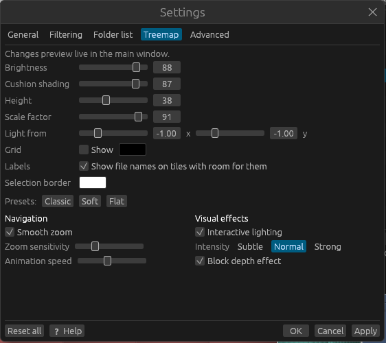

# Settings reference

Open **⚙ Settings** at the right of the toolbar. The window has five tabs. Changes preview in the
main window while the window is open; **OK** keeps them and closes the window, **Apply** keeps
them and leaves it open, and **Cancel** (or closing the window) throws them away. **Reset all**
puts every setting, on every tab (including the administrator choice), back to its default; press
**OK** or **Apply** to keep that.

Settings are saved when dirmap closes and are used the next time it starts. Settings marked
**needs a rescan** change what a scan finds; after changing one the status bar shows **Scan
settings changed. Rescan**.

## General

| Setting | Default | Effect |
|---|---|---|
| **Theme** <!-- setting:theme --> | Follow system | **Follow system**, **Dark** or **Light**. The help window follows it too. |
| **Sizes** <!-- setting:units --> | Binary | **Binary** (1 KB = 1,024 bytes, like Explorer) or **Decimal** (1 kB = 1,000 bytes, like drive makers and macOS). Also changes how typed sizes are read. See [Units](../disk-usage/sizes.md#units-binary-and-decimal). |
| **Striped rows in lists** <!-- setting:stripes --> | On | Shades every other row in the file manager and the side panel lists. |
| **Show folders and files as they are found** <!-- setting:live_tree --> | On | Shows a tree of folders filling in during a scan. Off shows only the progress bar. |

## Filtering

These are scan exclusions: they **need a rescan** and change the totals. See
[Scan exclusions](../filtering/scan-filters.md).

| Setting | Default | Effect |
|---|---|---|
| **Folders to skip** <!-- setting:exclude_folders --> | Empty | Full folder paths, one per line. Each folder and everything under it is skipped. |
| **File names to skip** <!-- setting:exclude_files --> | Empty | File name patterns with `*` and `?`, one per line, for example `*.tmp`. |
| **Only count file names matching** <!-- setting:include_files --> | Empty (all files) | If filled in, only files matching one of these patterns are counted. |
| **Skip files smaller than** <!-- setting:min_file_size --> | 0 KB (off) | Leaves out files below this size. |
| **Skip files not changed for** <!-- setting:max_age_days --> | 0 days (off) | Leaves out files last modified more than this many days ago. |

## Folder list

Name and Size are always shown.

| Setting | Default | Effect |
|---|---|---|
| **Percentage of parent (with bar)** <!-- setting:col_percent --> | On | Shows the **% of parent** column. |
| **Files** <!-- setting:col_files --> | On | Shows the **Files** column. |
| **Last change** <!-- setting:col_modified --> | On | Shows the **Last change** column. |

## Treemap

These change only how the treemap looks and moves; they never need a rescan. See
[Lighting and visual effects](../views/visual-effects.md).

| Setting | Default | Effect |
|---|---|---|
| **Brightness** <!-- setting:brightness --> | 88 | Overall brightness of the tiles (0–100). |
| **Cushion shading** <!-- setting:cushion --> | 87 | Strength of the shading that shows folder boundaries (0 = flat). |
| **Height** <!-- setting:height --> | 38 | How rounded each folder's cushion is. |
| **Scale factor** <!-- setting:scale --> | 91 | How much of the cushion shape carries down to deeper folders. |
| **Light from x** <!-- setting:light_x --> | −1 | Horizontal direction of the light (−2 to 2; negative is from the left). |
| **Light from y** <!-- setting:light_y --> | −1 | Vertical direction of the light (−2 to 2; negative is from the top). |
| **Grid: Show** <!-- setting:show_grid --> | Off | Draws a line around every tile. |
| **Grid colour** <!-- setting:grid_color --> | Black | Colour of those lines. |
| **Labels** <!-- setting:show_labels --> | On | Writes names (and sizes) on tiles with room for them, on the treemap and the sunburst. The same as **File names on tiles** in the filter bar. |
| **Selection border** <!-- setting:selection_color --> | White | Colour of the outline around the selected item. |
| **Presets** | | **Classic** restores the look settings above to their defaults, **Soft** gives gentler shading, and **Flat** turns shading off and the grid on. |
| **Smooth zoom** <!-- setting:smooth_zoom --> | On | Animates zooming, panning, opening folders and Back/Forward. Off makes every change happen at once (and turns off coasting after a drag). |
| **Zoom sensitivity** <!-- setting:zoom_sensitivity --> | Middle (1×) | How far each wheel step or trackpad movement zooms, from a quarter to three times the default. |
| **Animation speed** <!-- setting:anim_speed --> | Middle (1×) | How fast animations play, from half to two and a half times the default. Only with Smooth zoom on. |
| **Interactive lighting** <!-- setting:lighting --> | On | A soft light follows the pointer and the tile under it lifts slightly. |
| **Intensity** <!-- setting:light_level --> | Normal | **Subtle**, **Normal** or **Strong** pointer light. |
| **Block depth effect** <!-- setting:depth_effect --> | On | A slight bevel on tile edges so neighbouring tiles stand apart. |

## Advanced

| Setting | Default | Effect |
|---|---|---|
| **Stay on the scanned drive** <!-- setting:one_file_system --> | On | **Needs a rescan.** Linux and macOS: don't scan other drives mounted inside the scanned folder. The `--all-fs` command-line option turns it off for one run. Windows never follows drives mounted in folders either way. See [Links, junctions and mounted drives](../disk-usage/links-and-mounts.md). |
| **Skip hidden files and folders** <!-- setting:skip_hidden --> | Off | **Needs a rescan.** Leaves out hidden (and on Windows, system) files and folders. |
| **Scanner threads** <!-- setting:threads --> | 0 (automatic) | How many folders are read at once. 0 uses one per processor core (the number on this computer is shown). Network drives often scan faster with more, such as 32. Applies from the next scan. |
| **When dirmap starts** <!-- setting:admin --> | Ask if it isn't | Windows only: **Always run as administrator**, **Ask if it isn't**, or **Never (don't ask)**. **🛡 Restart as administrator now** restarts straight away. See [Running as administrator](administrator.md). |

## Remembered outside the Settings window

These are changed where you use them and also saved between runs:

| Setting | Where | Default |
|---|---|---|
| Recent Custom filter patterns <!-- pref:recent --> | Custom filter **⏷** menu | Empty |
| Custom filter presets <!-- pref:presets --> | Custom filter **⏷** menu | None |
| Case-sensitive matching <!-- pref:case_sensitive --> | **Aa** button, or the **⏷** menu | Off |
| Match any term (OR) / Match all terms (AND) <!-- pref:match_all --> | Custom filter **⏷** menu | Match any |
| Highlight / Show matches only <!-- pref:mode --> | Filter bar, when a filter is on | Highlight |
| Window size and position, panel sizes | The window itself | |

## Where settings are stored

| System | Location |
|---|---|
| Windows | `%APPDATA%\dirmap\data\` |
| Linux | `~/.local/share/dirmap/` (or `$XDG_DATA_HOME/dirmap/`) |
| macOS | `~/Library/Application Support/dirmap/` |

The folder holds `app.ron` (all of the above) and `admin-mode` (the administrator choice, kept
separately because it's needed before the window opens). To start afresh, close dirmap and delete
the folder, or use **Reset all**.

## Related topics

- [Scan exclusions](../filtering/scan-filters.md)
- [Lighting and visual effects](../views/visual-effects.md)
- [Running as administrator](administrator.md)
