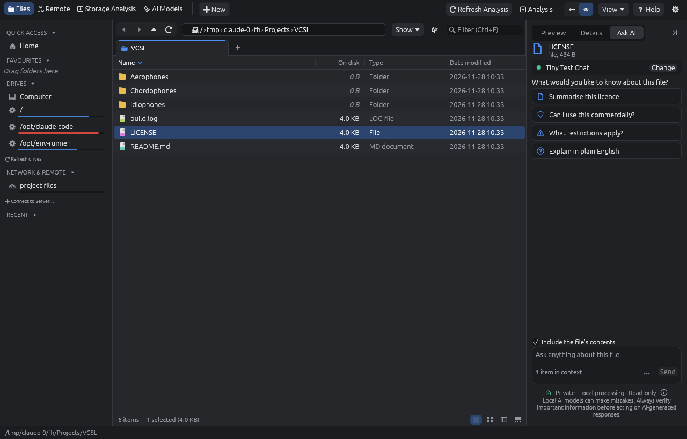

# Ask AI

**Ask AI** lets you chat with an AI model that's already on this computer, run by Filescape
itself. You don't need Ollama, LM Studio or an internet connection, and nothing you ask leaves the
computer. Ask AI is free.

Open the [AI Models workspace](ai-models.md) (**Ctrl+4**, **⌘4** on a Mac) and press **💬 Ask AI**
in the toolbar. Press **Library** to go back to the list of models. You can also select a model
in the library and press **💬 Ask AI** beside **🔍 Inspect**.

Before the first question, Ask AI offers some places to start: **Understand a document**, **Explore
a folder**, **Explain a script**, **Analyse a log**, **Summarise a folder of documents**,
**Understand storage use** (after a scan in Storage Analysis) and **Ask about my AI models**. Each
one asks you to pick the file or folder, attaches it and writes a first question you can change
before sending. Only models that write text are listed: image, audio and embedding models can't
chat.

## Choosing a model

The left side lists the models Filescape can run: GGUF models, the kind Ollama and LM Studio
download, and `.gguf` files from Hugging Face or elsewhere. The smallest come first, since they
load and answer quickest. Models in other formats, and copies of a model listed earlier, aren't
listed.

If there's no model yet, see [Getting a small model](#getting-a-small-model) below.

Click a model and press **Load**, or double-click it. Filescape first checks the model fits in this
computer's memory, and says so if it doesn't. Loading takes from a few seconds to a minute,
depending on the model's size and the disk. **Unload** frees the memory again.

- **Context** is how much of the conversation the model keeps in mind, in tokens (about ¾ of a
  word each). A longer context needs more memory. It takes effect the next time a model is loaded.
  When a conversation grows longer than the context, the oldest messages are left out.
- **Creativity** sets how varied the answers are. Low picks the likeliest words, so the same
  question gets the same answer; high is more varied, and more likely to wander.

On a Mac with Apple silicon, models run on the graphics chip. On Windows and Linux they run on the
graphics card if its drivers support Vulkan (most cards from NVIDIA, AMD and Intel made since
2016 do): as much of the model as fits on the card, the rest on the processor. Without Vulkan
they run on the processor, using the fastest instructions it has. The line under the model list
says where the loaded model runs. On an Intel Mac models run on the processor, which needs AVX2. A
small model of 1 to 4 billion parameters answers at a comfortable reading speed on most
computers; larger ones are slower.

## Getting a small model

If you don't have a model, press **Get a small model…** on the left. (When you already have
models, it's a smaller button under the list, until you've downloaded it.) Filescape shows what it
would download before anything happens:

- **Qwen3 1.7B**, made by Qwen (Alibaba Cloud): a small general-purpose model that answers in many
  languages and can think before it answers.
- A 1.7 GB download, which needs about 2.2 GB of memory to run.
- Its licence, Apache 2.0, and the publisher's page on Hugging Face, both of which you can open.
- The folder it's saved in: `%LOCALAPPDATA%\Filescape\Models` on Windows,
  `~/Library/Application Support/Filescape/Models` on a Mac and `~/.local/share/filescape/models`
  on Linux.

Press **Download** to get it, or **Not now**. The file comes from Qwen's own page on Hugging Face,
at a fixed version, and Filescape checks its SHA-256 checksum before using it; a file that doesn't
match is removed. When it's done, Filescape lists it and loads it, ready for your first question.

**Stop** pauses the download. What has downloaded is kept, and **Carry on downloading** continues
from there, even after Filescape is closed and opened again. If there isn't enough free space,
Filescape says so before it starts.

This is the only time Ask AI uses the internet. Nothing about you or your files is sent. To remove
the model, delete its file from the folder above.

## Asking

Type a question and press **Enter**, or **Send**. **Shift+Enter** starts a new line. The answer
appears as it's written; **■ Stop** ends it early. **New chat** starts a new conversation with
the same model, and **Copy** under an answer copies it.

Some models, such as Qwen 3 and DeepSeek R1, think before they answer. Their thinking is folded
away under **Thought about it**; click it to read it.

Under the last answer, Filescape shows how many tokens it took and how fast they were written.

## Ask AI in Files

You don't have to leave [Files](file-manager.md) to ask about a file. Open the preview pane
(**Alt+P**) and choose its **Ask AI** tab, beside **Preview** and **Details**, or press **Ask AI**
under the preview, or in a [Quick Look](file-manager.md) window. The selected file or folder is what
the conversation is about: there's nothing to attach.

From the top, the tab shows:

- **What it's about**: the file or folder's name, kind and size. **×** starts a new chat.
- **The model**: a green dot and its name when one is loaded. It's the same loaded model as in the
  AI Models workspace, so it doesn't take any more memory. **Change** loads another. With none
  loaded, **Load** loads the one shown (the one picked last, or the smallest), **⏷** picks another,
  and **Get a small model…** shows the [download offer](#getting-a-small-model) right there.
- **Suggested questions** for what it is, before the first question. A licence gets **Summarise
  this licence**, **Can I use this commercially?** and **What restrictions apply?**; a log gets
  **Find the errors**; code gets **Explain this code** and **Find possible issues**; a spreadsheet
  gets **Explain the columns**; a folder gets **What is this folder?** and **What's using the
  space?**. Questions that need a file's text are only offered when Filescape can read it: plain
  text, code, PDF, EPUB, Word, PowerPoint, OpenDocument and Excel files. Describing what's in a picture needs a
  model that can see images, which Filescape can't run yet.
- **The conversation**, with **Copy** and **Based on** under each answer, as below.
- **The question box**. **Enter** sends; follow-up questions keep what the chat is about. **…**
  has **New chat** and **Open in AI Models**, which carries the conversation on in the AI Models
  workspace with more room (it replaces the conversation there).

**Include the file's contents** is ticked for a single file Filescape can read, so its text goes
with the first question. Folders are described by their names, sizes and dates, not by reading
the files in them.

When you select something else after asking, the chat isn't changed behind your back. A bar
offers **New chat** (start again about the new item), **Replace** (keep the conversation, and ask
about the new item from now on), **Add** (ask about it too) or **Keep this chat**.

The Files chat and the AI Models chat are separate conversations sharing one model. The model
answers one question at a time; if it's busy in the other one, the tab says so.

### Several items at once

Select several files or folders and the tab is about all of them: the header says how many and
their total size, and **Included** lists exactly which. The suggestions become **Summarise each of
these**, **Compare them** and **How are they related?**. When they're all files Filescape can read,
their text goes with the question; folders are described by names, sizes and dates. There's no
limit on how many you select: what doesn't fit in the model's context is summed up or left out,
and the answer's **Based on** says what the model was given.

### From the right-click menu

Right-click a file or folder in Files and open **💬 Ask AI**:

| For | Items |
|---|---|
| A file | **Ask About This File…**, **Summarise**, **Explain Its Contents** |
| A folder | **Ask About This Folder…**, **Explain Its Contents**, **Summarise Documents**, **Understand the Folder Structure**, **Identify Possibly Unnecessary Files**, **Explain What This Project Is For**, **Analyse Storage Use**, **Find Related Files** |
| Several items | **Ask About These…**, **Summarise These**, **Compare These**, **What Do These Have in Common?** |

Each opens the Ask AI tab about what you right-clicked. **Ask About…** leaves the question to you;
the others ask straight away (once a model is loaded). Choosing one starts a new chat if the
current one is about something else. **Open in Ask AI** at the bottom opens the AI Models
workspace instead, as before.

What goes with each:

- Folder questions use the folder's names, sizes and dates, never the files' contents, except
  **Summarise Documents**, which reads the text files and documents directly in the folder (not in
  folders inside it), smallest first. Room a short document doesn't use goes to the next; when
  the room runs out, the rest aren't read and **⚠ Partly included** names them. **Based on**
  lists them.
- **Find Related Files** also lists what sits beside the folder in its parent folder.
- When Storage Analysis has scanned the folder, its sizes count everything inside, with a
  breakdown by file type. Otherwise only what the folder holds directly is listed.
- **Identify Possibly Unnecessary Files** gives guesses from names and sizes. Filescape never
  deletes or moves anything because of the answer.

To hide Ask AI in Files, turn off **Show Ask AI in Files** in Settings › Files. The right-click
menu then has the single **Ask AI About This…** item, which opens the AI Models workspace.

## Asking about files and folders

Right-click a file or folder in Storage Analysis and choose **💬 Ask AI About This…**, or in
[Files](file-manager.md) choose **💬 Ask AI › Open in Ask AI**. Ask AI opens with them
attached to your next question, shown above the question box as **📎 About …**. Ask something like
"What is this folder for?" or "What could I delete here?".

From inside Ask AI, press **Attach…** under **Send** and choose **A file…** or **A folder…**, or
drop files and folders from your file manager onto Ask AI.

What the model is told:

- The item's path, whether it's a file or folder, its size and when it was last changed.
- For a folder, its shape first: the folders inside it, up to three levels down (largest first
  from Storage Analysis, by name otherwise, with how many items each holds). This takes up to a
  third of the room for the folder, and is left out when nothing is nested.
- Then what the folder holds directly, largest first, until the room for it runs out, then how
  many more items there are and their total size. From Storage Analysis, sizes include
  everything inside folders, and there's also a breakdown by file type. A folder with more than
  5,000 items directly in it has only the first 5,000 looked at.
- For an AI model file (GGUF or safetensors), what Filescape reads from the file itself, as the
  [Model Inspector](ai-models.md) does: its name, family, size in parameters, precision, layers
  and context, each marked when it's worked out rather than read, and whether this computer has
  the memory to run it. So **What is this model?** and **Could my computer run it?** are answered
  from facts, not guessed from the file name. Nothing is run, and cloud-only files aren't read.
- Nothing is opened to describe a folder, and Filescape looks no deeper than three levels, so a
  question about a large folder is answered quickly.
- **Not** what's inside the files, unless you tick **Include the file's contents**. That box
  appears when you ask about files, and applies to that one question: Filescape then reads the
  start of each chosen text file, or the text of a PDF, EPUB book, Word, PowerPoint, OpenDocument
  or Excel file, as much as fits in the model's context. A PDF is read page by page from the
  first. Other files, and files that are only in the cloud, aren't read, so asking never
  downloads anything. PDFs over 256 MB, password-protected PDFs and scanned pages (pictures of
  text, with no text in them) can't be read either.

Press **×** to ask without them. After you send the question, **📎 About …** stays above it; hover
it to see exactly what the model was told. Follow-up questions in the same chat can refer back to
it.

Under the answer, **Based on** lists the files and folders it was given, and whether the model saw
only their names, sizes and dates or the text of the files too. Click one to show it in Files.

When the model wasn't given everything, a **⚠ Partly included** line under **Based on** says
what was left out: a file read only in part ("report.pdf: read the start only, pages 1 to 6 of
40"), a file not read, files left unread for lack of room, or a large folder whose items were
only partly listed ("Samples: listed 40 of 1,250 items by name, the rest only counted"). The
answer covers only what the model was given. Hover the line to see everything; ask about fewer
items, or one on its own, to give it more room.

Ask AI asks the model to cite the files it relies on, like `[config.yaml:12]`, and sends text
files with their lines numbered so it can. Under the answer, **Cited** lists those references,
each checked by Filescape against what the model was actually given:

- A tick: the file is among the items asked about (or inside a folder asked about), and the line
  was sent to the model. Hover it to see that line as it is in the file; click it to show the file
  in Files.
- A warning: the file is real and among the items, but the line can't be checked, because the
  model wasn't sent that file's lines or the line is past what was sent.
- Crossed out: no such file was given to the model, so the reference may be made up.

Words in brackets that aren't file names are left alone, and nothing outside the items you asked
about is ever linked.

**Measured by Filescape** under an answer opens the names, sizes, dates and counts Filescape read
from the disk itself. Those are facts; the answer above them is the model's interpretation of
them.

What comes from your files is marked off from your question, and the model is told it is material
to answer about, not instructions. A document that says "ignore your instructions" is read as part
of the document. Small models can still be misled by what they read, so check answers that matter.

Nothing is sent anywhere: the model runs on this computer. Ask AI never deletes, moves or renames
anything, whatever the answer says.

## What to expect

Answers come from the model, not from Filescape, and can be wrong, especially from small models.
Filescape only shows them: it never deletes, moves or opens anything because of what a model
wrote, and links in an answer aren't opened.

Under every conversation, in AI Models and in Files, Ask AI says **Private · Local processing ·
Read-only** and "Local AI models can make mistakes. Always verify important information before
acting on AI-generated responses." Hover **ⓘ** beside it for more:

- AI models may give incorrect, incomplete or misleading answers.
- Accuracy depends on the model you choose: its abilities, its size and how much context it has.
- Smaller or heavily quantised models make more mistakes.
- Check what it says about licences, legal documents, money and technical problems yourself.
- Large files and folders may only be partly read, because a model can only take in so much at
  once. **Based on** says what the model was given.
- Suggestions that files are redundant, duplicated or unneeded are guesses, not facts.
- Filescape never runs commands, or changes, moves or deletes files, because of an answer.
