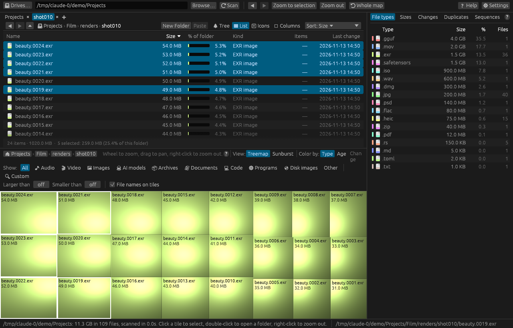
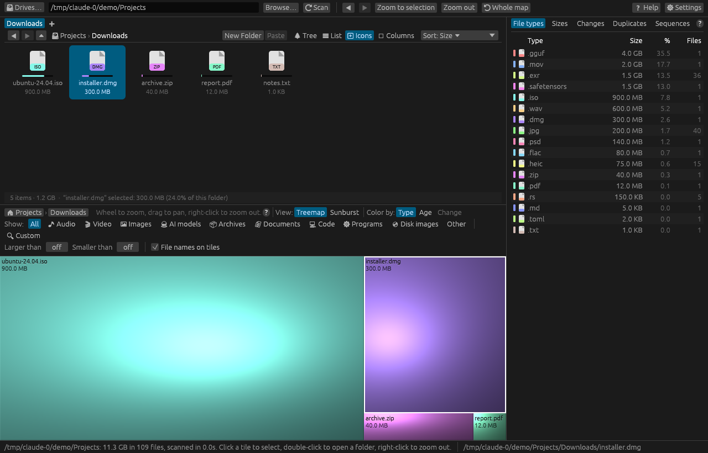
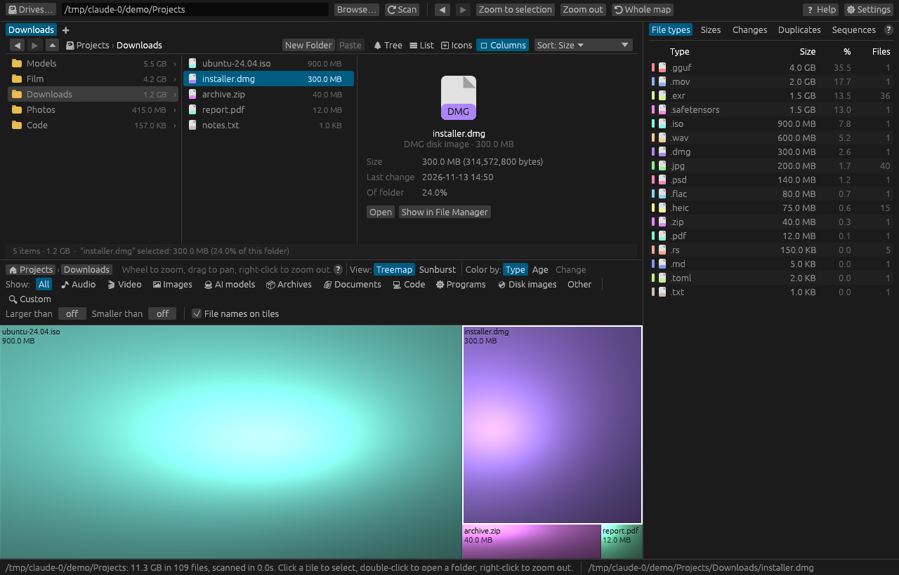

# The file manager

The top part of the window is a file manager for what you scanned, like Finder or Windows
Explorer: folders you open by double-clicking, a path you can click, Back and Forward, tabs, and
the usual list, icon and column layouts. Unlike a file manager, every item shows how much space
it uses and its share of the folder, and you can sort by size. The map stays underneath and
follows you around, so you can see where the space goes while you manage the files.

Drag the border between the file manager and the map to give either more room.

## Layouts

Pick a layout with the buttons at the top right of the file manager. Each tab remembers its own.

| Layout | What it shows |
|---|---|
| **☰ List** | One line per item, with **Size**, **% of folder** (with a bar), **Kind**, **Items** (files inside a folder, at any depth) and **Last change**. Click a column heading to sort by it. In a narrow window the less important columns are left out. |
| **⊞ Icons** | A grid of large icons with each item's name and size, and a thin bar under the icon showing its share of the folder. |
| **◫ Columns** | One column per folder, from the top of the scan down to the current folder. Selecting a folder shows what's inside it in the next column; selecting a file shows its details there, with **Open** and **Show in Finder** (or Explorer) buttons. |
| **🌲 Tree** | The whole scan as a tree that opens folder by folder. See [The directory tree](directory-tree.md). |

## Moving around

| Action | What it does |
|---|---|
| Double-click a folder | Opens it. The map zooms to it too. |
| Double-click a file | Opens it with its usual app. |
| Click a folder in the path | Goes to that folder. |
| **◀** and **▶** | Back and Forward through the folders you've opened. The mouse's side buttons and **Alt+←** / **Alt+→** (**⌥←** / **⌥→** on a Mac) do the same. |
| **⏶**, or **Backspace** | Up to the enclosing folder. The folder you were in stays selected. |

The keyboard works as it does in a file manager: **↑** and **↓** move the selection, **Enter**
opens the selected folder, and typing the start of a name jumps to it. In **Icons** the **←**
and **→** keys move along a row; in **Columns** they go up a level and into the selected folder.
The full list is in [Keyboard shortcuts](../reference/keyboard.md#file-manager).

### The file manager and the map move together

- Opening a folder in the file manager zooms the map to it.
- Zooming the map (double-click, the wheel, right-click, the breadcrumbs or **⟲ Whole map**)
  takes the file manager to the folder the map shows.
- Clicking something on the map, in the Duplicates tab or in any other list selects it in the
  file manager, opening the folder that holds it. The map doesn't move.

### Which part the keys go to

The keys go to whichever part you clicked last. After a click in the file manager, the arrow keys,
**Backspace**, **Ctrl+A** and the rest work there; after a click on the map, the map's own keys
(**+**, **−**, **Home** and **Alt+←**) work instead. The file manager's selection turns grey while
the map has the keys. Commands such as **Delete** and **Ctrl+C** work on the selection either
way.

## Tabs

Each tab shows its own folder, with its own Back and Forward history and its own layout.

| Action | What it does |
|---|---|
| **Ctrl+T** (**⌘T**), or **+** after the last tab | A new tab showing the same folder. |
| Middle-click a folder, or **Open in New Tab** on its right-click menu | Opens that folder in a new tab. |
| Click a tab | Switches to it. The map follows. |
| **Ctrl+W** (**⌘W**), **×** on the tab, or middle-click the tab | Closes it. The last tab can't be closed. |
| **Ctrl+Tab** / **Ctrl+Shift+Tab** | The next or previous tab. |

## Selecting several items

- **Ctrl+click** (**⌘-click** on a Mac) adds an item to the selection or takes it out.
- **Shift+click** selects everything from the last item you clicked to this one.
- **Ctrl+A** (**⌘A**) selects everything in the folder.
- A click on an empty part of the view clears the selection.

The bottom of the view shows how many items the folder holds, their total size, and the size of
what's selected. The map outlines every selected item. Copy, Cut, Delete, Move to and dragging
work on all of them; Rename works on one item at a time.

## Working with files

| Command | Shortcut | What it does |
|---|---|---|
| **New Folder** | **Ctrl+Shift+N** (**⌘⇧N**) | Makes a folder in the current folder and asks for its name. |
| **Rename…** | **F2** | Renames the item. The name is selected without its extension, so typing replaces just the name. |
| **Copy** | **Ctrl+C** (**⌘C**) | Remembers the items to paste. |
| **Cut** | **Ctrl+X** (**⌘X**) | Remembers the items to move when you paste. |
| **Paste** | **Ctrl+V** (**⌘V**) | Copies or moves them into the current folder. **Paste Into Folder** on a folder's right-click menu puts them in that folder instead. |
| **Copy Path** | **Ctrl+Shift+C** (**⌘⇧C**) | Copies the full path to the clipboard as text. |

**New Folder** and **Paste** are also buttons on the file manager's toolbar, and on the
right-click menu of an empty part of the view.

A copy never replaces anything: if an item of that name is already there, the copy is called
`name copy.ext` (then `name copy 2.ext` and so on). A move stops and says so instead.

Copy and Cut work inside dirmap: you can't paste the files into Finder or Explorer. Their paths
do go on the clipboard as text, one per line, so you can paste them into a terminal or a
document. It works the other way too: paste paths copied elsewhere (one per line, such as
Explorer's **Copy as path**) and dirmap copies those items into the current folder.

### Drag and drop

Drag items onto a folder, a folder in the path, a tab or an empty part of the view to move them
there. Hold **Alt** (**⌥** on a Mac) when you let go to copy them instead. Dragging an item
that's part of the selection drags the whole selection.

### Things to know

- There's no Undo. A move or rename can be reversed by doing it again the other way; use
  **Delete (to Recycle Bin)** rather than **Delete Permanently** if you might want something back.
- Only one file operation runs at a time. Its progress shows in the status bar.
- Moving to another drive copies the items and then deletes the originals.

## Sorting

The **Sort** menu, or a click on a List column heading, chooses the order. Pick the same one
again to reverse it.

- **Size**, **Items** and **Last change** start with the largest, fullest or newest.
- **Name** and **Kind** sort A to Z with folders first, like Explorer. Numbers in names are
  sorted by value, so `shot2` comes before `shot10`.

The order applies to every layout, tab and folder.

## Filters

The **Show:** categories, **Larger than** / **Smaller than** and the **🔍 Custom** filter work
here as they do on the maps. See [Filtering overview](../filtering/overview.md).

- With **Highlight**, files that don't match and folders with no matches inside are greyed out.
- With **Show matches only**, they're left out altogether, and folder sizes count only the
  matching files.

The **Color by** setting colours the size bars (and, on macOS and Linux, the file icons) the same
way it colours the map.

## Right-click menu

Right-click any item for Open, Copy, Cut, Rename, New Folder, Copy Path, Show in Finder or
Explorer, open a terminal there, Refresh, Properties, Compute Hash, Add to Exclusion Filter,
Delete, Move to and so on. With several items selected the commands act on all of them. The
first item on a folder is **Open Folder**, which opens it in the file manager. See
[Right-click menus and file operations](../analysis/file-operations.md).

**Enter** on a folder opens it in the file manager rather than in Finder or Explorer.

## Icons

On Windows the file manager uses Explorer's own icons. On macOS and Linux it draws a folder or a
page in the file type's colour, with the extension written on the larger icons.

## Not yet available

The file manager looks at the scan, so it shows what was there when you scanned, plus the changes
you make in dirmap. Changes made in other apps show after a **Refresh** (**F5**) or a rescan. You
can't drag files in from, or out to, other apps.

## Related topics

- [The directory tree](directory-tree.md)
- [The treemap](treemap.md)
- [The sunburst](sunburst.md)
- [Keyboard shortcuts](../reference/keyboard.md#file-manager)
- [Mouse controls](../reference/mouse.md#file-manager)
