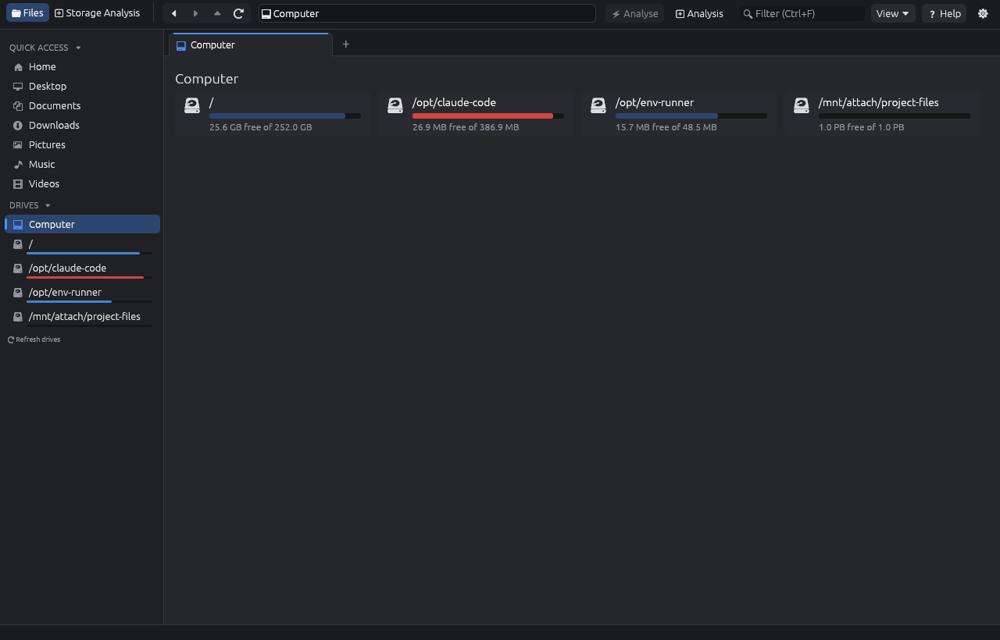

# The Files workspace

dirmap opens in the **Files** workspace: a file manager like Windows Explorer, Finder or Dolphin.
You can browse your computer straight away, with no scan. When you want to know where the space
goes, open the [analysis dock](#the-analysis-dock) under the list: it shows the treemap of the
folder you're in, and follows you as you browse.

## Workspaces

The buttons at the left of the toolbar switch between the two workspaces. dirmap reopens in the
one you used last.

| Workspace | What it's for |
|---|---|
| **🗀 Files** (**Ctrl+1**, **⌘1** on a Mac) | Browse drives, folders and network shares, and open files. Folders are read from the disk as you open them, so there's nothing to wait for. |
| **⊞ Storage Analysis** (**Ctrl+3**, **⌘3**) | The scan, with its [file manager](file-browser.md), [treemap](treemap.md), sunburst, file types, duplicates, snapshots and sequences. |

Switching keeps your place:

- **Files to Storage Analysis.** If the scan includes the folder you're in, Storage Analysis opens
  at that folder, with the same item selected.
- **Storage Analysis to Files.** Files shows the folder Storage Analysis is showing, with the same
  item selected.

Starting dirmap with a folder (`dirmap D:\Projects`) or a snapshot to compare (`--compare`) opens
Storage Analysis and scans it, as before.

A scan keeps running while you browse in Files. The right of the status bar shows it, and any
other work running in the background (finding duplicates, applying a filter, file commands);
click it for details.

## The sidebar

| Group | What's in it |
|---|---|
| **Quick access** | Home, Desktop, Documents, Downloads, Pictures, Music and Videos (and Applications on a Mac). These are your real folders, including ones that have been moved, such as Documents on OneDrive. |
| **Pinned** | Folders you've pinned. Right-click any folder, place or drive and choose **Pin to Sidebar**. Right-click a pinned folder to unpin it or move it up or down. |
| **Drives** | **This PC** (Windows) or **Computer** (Linux and macOS), then each drive or mounted volume, network drives included. Each has a bar showing how full it is, red when over 90%. Hover for the free space. |
| **Recent** | The last ten folders you opened. |

Click an entry to go there. Middle-click opens it in a new tab. Click a group's title to fold it
away. Drag the sidebar's edge to make it wider.

## Moving around

- **◀ ▶** go Back and Forward through the folders you've opened in this tab. **Alt+←** and
  **Alt+→** do the same, as do the mouse's side buttons.
- **⏶** (or **Backspace**) goes up a level. Above a drive is the **Computer** view, which shows
  every drive with its space.
- **⟳** (or **F5**) reads the folder again.
- **The path.** Click any part of it to go there. Click the empty space after it, or press
  **Ctrl+L**, to type a path:
  - `D:` means the whole drive;
  - `~/Projects` is in your home folder;
  - `\\server\share` opens a Windows share.
- **Double-click** a folder to open it, or a file to open it with its usual app. **Enter** does
  the same for the selected item.

## The toolbar

From left to right:

- the workspaces;
- **⏴ ⏵ ⏶ ⟳**: Back, Forward, Up and Refresh;
- the path;
- **⚡ Analyse Folder**, which becomes **⟳ Refresh Analysis** when the folder is already
  analysed, or **■ Cancel Scan** while a scan runs (see [the analysis dock](#the-analysis-dock));
- **⊞ Analysis**, which shows or hides the dock;
- the filter, the **View** menu, Help and Settings.

The **View** menu has:

- **Hidden Items**, which shows hidden files and folders;
- **Comfortable** or **Compact** rows;
- **Reset Column Widths**;
- **Analysis Dock**.

## Tabs

Each tab has its own folder and history. **Ctrl+T** opens a tab, **Ctrl+W** closes one,
**Ctrl+Shift+T** reopens the last one you closed, and **Ctrl+Tab** moves between them.
Middle-click a folder to open it in a new tab. Drag a tab to move it along the strip, and
right-click one for **Close Other Tabs**. When there are more tabs than fit, they get narrower,
then the strip scrolls. Your tabs are there again the next time you start dirmap.

## The list

| Column | What it shows |
|---|---|
| **Name** | The file or folder. Hidden items are drawn fainter. An arrow on the icon marks a link (a shortcut, symlink or junction). |
| **Size** | The file's size. A folder shows its total in *italics* when the current scan includes it. Hover for the number of files. Without a scan, folders show no size. |
| **Type** | Folder, or the file's kind, for example "EXR image" or "SAFETENSORS AI model". |
| **Date modified** | When the item was last changed. |

Click a heading to sort by it, and again to reverse. Folders always come first, and names
sort in natural order, so `shot2` comes before `shot10`. Drag the divider at a column's left edge
to resize it, and double-click the divider to put the column back to its usual width. dirmap
remembers the widths.

To choose items:

- **Ctrl+click** adds or removes one item.
- **Shift+click** (or **Shift+↑**/**↓**) selects a range.
- **Ctrl+A** selects everything shown, and **Escape** selects nothing.
- **Typing** the start of a name jumps to it.

The bar under the list counts the items and adds up the size of what's selected.

- **Filter** (**Ctrl+F**) shows only the names containing what you type. `*` and `?` work as
  wildcards, for example `*.exr` or `shot_??.png`. **Escape** clears it.
- **View > Hidden Items** (**Ctrl+Shift+.**) shows hidden files and folders: names starting with
  a dot, and items marked hidden on Windows.

## Right-click menu

| Command | What it does |
|---|---|
| **Open** / **Open in New Tab** | Opens folders here or in a new tab, and files in their apps. |
| **Copy Path** (**Ctrl+Shift+C**) / **Copy Name** | Puts the full paths, or just the names, on the clipboard, one per line. |
| **Show in Explorer** (Finder, or the system file manager) | Opens the system's file manager with the item selected. |
| **Open in Terminal…** (Command Prompt or PowerShell on Windows) | Opens a terminal in the folder. |
| **Pin to Sidebar** / **Unpin from Sidebar** | Adds the folder to **Pinned**, or takes it off. |
| **Analyse This Folder** | Scans the folder and shows it in the [analysis dock](#the-analysis-dock). You stay in Files. |

## The analysis dock

The analysis dock shows the treemap (or the sunburst) of the folder you're in, under the list.
You can see where the space goes while you browse, without switching to Storage Analysis.

- **Open it** with **⊞ Analysis** on the toolbar, **View > Analysis Dock**, or **Ctrl+J** (**⌘J**
  on a Mac).
- **Resize it** by dragging the line above it. The list and the dock each keep at least a few
  rows.
- **🗖** makes the dock as tall as possible, and **🗗** puts it back.
- **⛶** opens the same folder in the full Storage Analysis workspace.
- **✖** closes it.

dirmap remembers whether the dock is open, and its height.

### Analysing a folder

The dock never scans on its own. If the folder hasn't been analysed, it says so and offers
**⚡ Analyse This Folder**. The scan runs in the background, and the dock shows its progress:

- files and folders found;
- the bytes counted and the time taken;
- the folder being read;
- any it couldn't read.

You can keep browsing, in this tab or others, and **■ Cancel Scan** stops it. The percentage is
shown only for whole drives, where the used space gives a real total.

When it's done, the treemap appears. From then on, every folder inside the analysed one shows
its treemap straight away, with no rescanning. If you analysed a whole drive, that's every
folder on it.

If a folder is already analysed, the button says **⟳ Refresh Analysis**. That scans only this
folder again and puts the result into the existing analysis, so a whole-drive analysis is kept.

dirmap also keeps the last two analyses you replaced (if each is under 2 million files). Going
back to a folder one of them covers shows it again at once.

### What the map shows as you browse

Choose with the menu on the dock's toolbar:

| Mode | The map shows |
|---|---|
| **Follow folder** (the usual) | The folder open in the list. Switching tabs switches the map too. |
| **Pinned** | The folder that was on the map when you chose Pinned, wherever you browse. **📌** shows which. |
| **Follow selection** | The folder selected in the list, without opening it. With a file selected, the open folder, with the file outlined. |

Moving between a folder and its subfolders zooms the map in or out, so you can see where you
went.

### The list and the map together

- **Selecting in the list** outlines the item on the map. With several selected, each one is
  outlined.
- **Clicking a tile** selects it, and selects the item in the list that holds it.
- **Double-clicking a tile** opens its folder in the list.
- **Right-clicking a tile** gives the same menu as the list, plus **Open in List** or **Show in
  List**.
- **⌖** zooms to the selection, and **⟲** goes back to the whole folder.

The wheel, dragging, and the **+**, **−** and **Home** keys work as in
[Storage Analysis](treemap-navigation.md) while the pointer is over the map.

### The information line and the legend

The line above the map shows:

- **Analysed**, **Changed since analysis**, **Analysed with filters**, **Scanning** or **Not
  analysed**;
- the folder's size, files and folders;
- its largest subfolder and largest file;
- when it was analysed.

**Changed since analysis** means the list doesn't match the analysis: something analysed has
gone, a file's size has changed, or something was modified after the analysis. **⟳ Refresh
Analysis** brings it up to date.

Under the map, the legend lists the file types taking the most space in the folder, in their map
colours. Click one to highlight those files on the map, and click it again to stop. **Colour**
on the dock's toolbar switches to colouring by age, or by change since a snapshot.

## Copying, moving and deleting

Rename, copy, move and delete aren't in the Files workspace yet. They're planned for the next
stage, with a progress window, conflict handling and Undo. Until then, use the
[file manager in Storage Analysis](file-browser.md), which has all of them.

## Slow and unreachable drives

Folders are read in the background, a batch at a time, so a folder of 100,000 files starts
showing at once, and the window never freezes. If a network share or a sleeping disk takes more
than two seconds to answer, the list says so and offers **Cancel**. You can use other tabs,
drives and Storage Analysis while you wait.

If a folder can't be opened, the list says why, for example because it doesn't exist or you
don't have permission, and offers **Go up**.

## Related topics

- [The file manager in Storage Analysis](file-browser.md)
- [Scanning a drive or folder](../getting-started/scanning.md)
- [Keyboard shortcuts](../reference/keyboard.md)
- [External and network drives](../advanced/network-drives.md)
