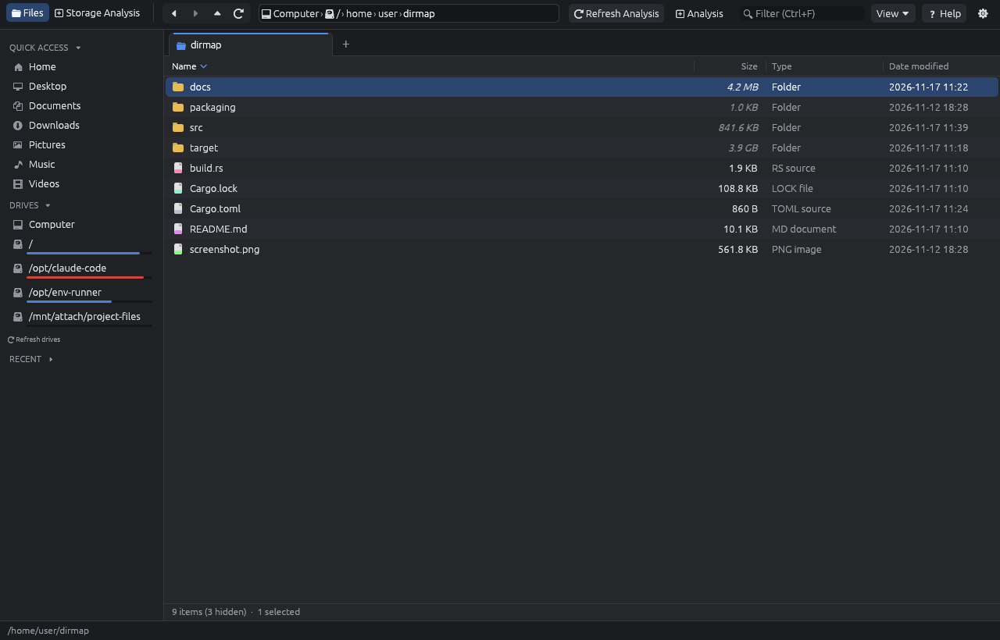
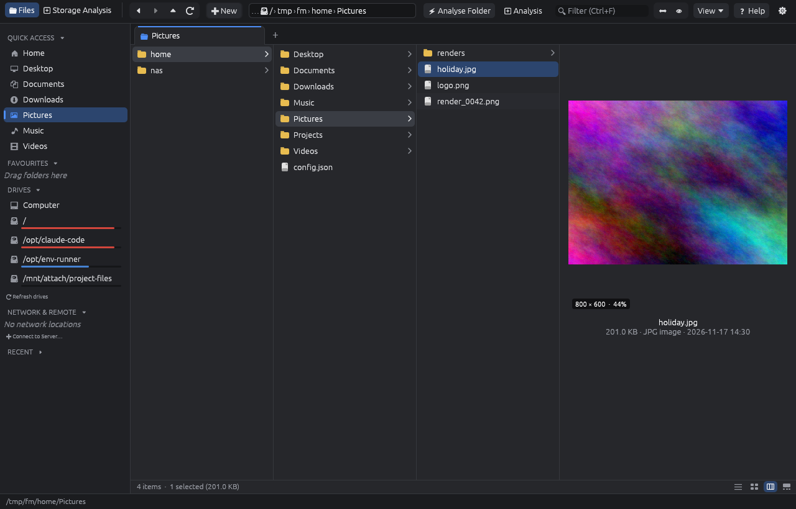
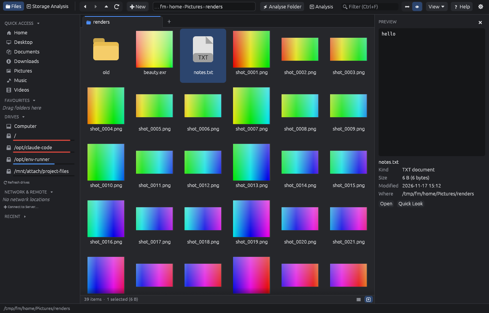
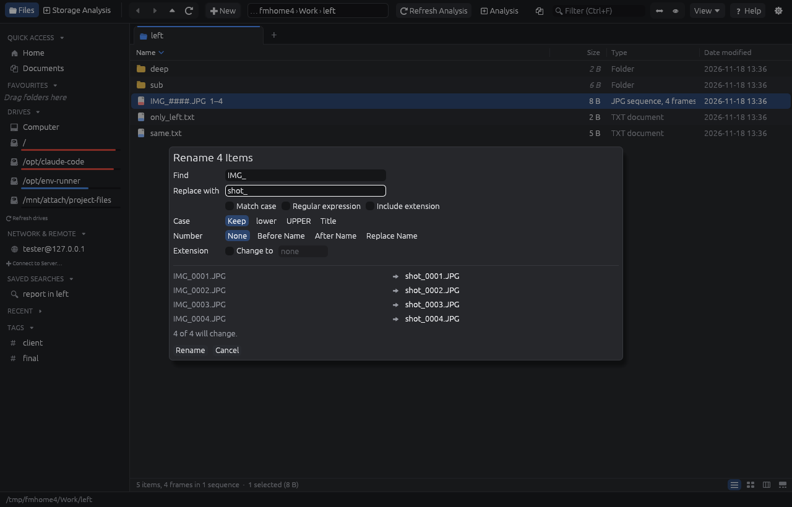
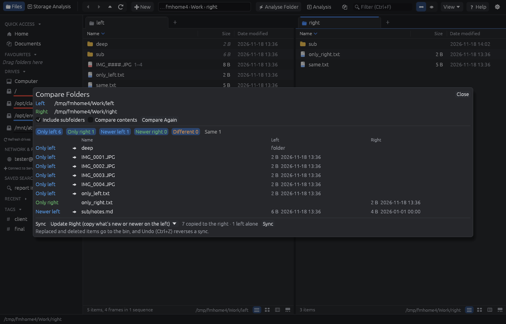
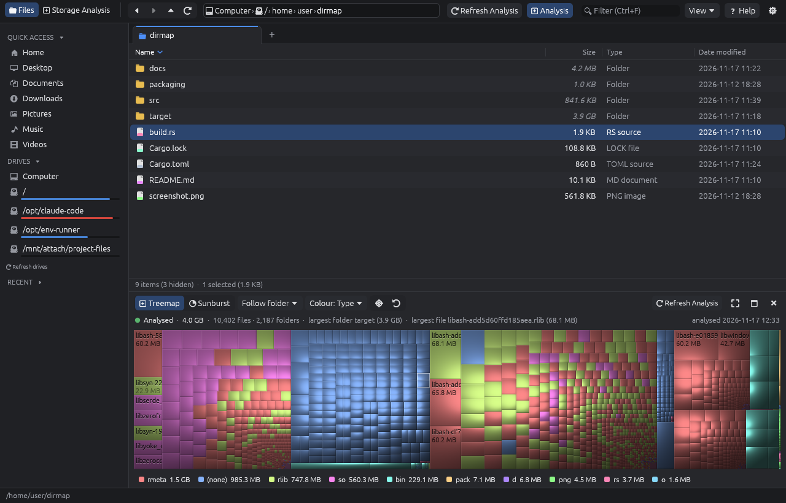
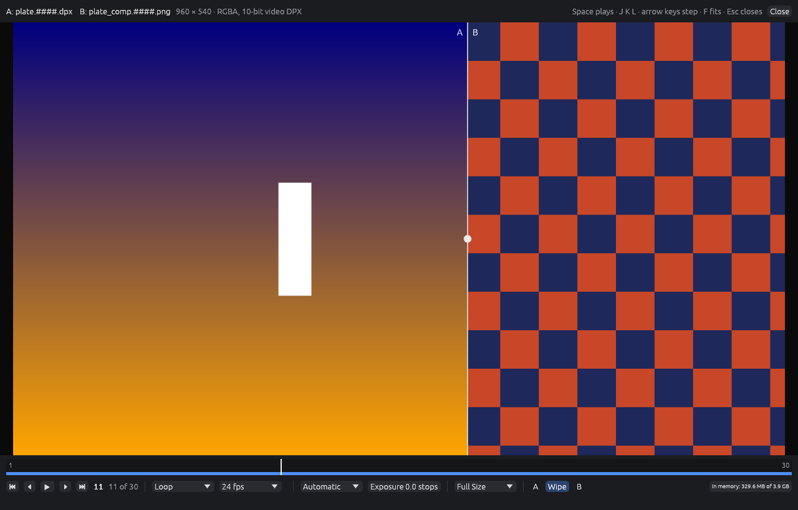
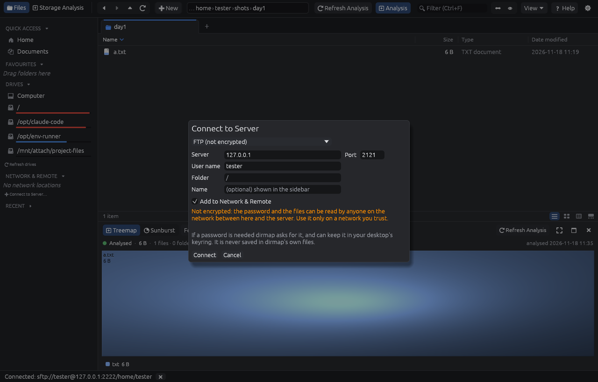

# The Files workspace

Filescape opens in the **Files** workspace: a file manager like Windows Explorer, Finder or Dolphin.
You can browse your computer straight away, with no scan. When you want to know where the space
goes, open the [analysis dock](#the-analysis-dock) under the list: it shows the treemap of the
folder you're in, and follows you as you browse.

## Workspaces

The buttons at the left of the toolbar switch between the four workspaces. Filescape reopens in the
one you used last.

| Workspace | What it's for |
|---|---|
| **🗀 Files** (**Ctrl+1**, **⌘1** on a Mac) | Browse drives, folders and network shares, and open files. Folders are read from the disk as you open them, so there's nothing to wait for. |
| **🖧 Remote** (**Ctrl+2**, **⌘2**) | This computer beside a server, with saved sites and quick connect. It's this file manager with its own panes: see [The Remote workspace](remote.md). |
| **⊞ Storage Analysis** (**Ctrl+3**, **⌘3**) | The scan, with its [file manager](file-browser.md), [treemap](treemap.md), sunburst, file types, duplicates, snapshots and sequences. |
| **✨ AI Models** (**Ctrl+4**, **⌘4**) | The AI models on this computer, from Ollama, LM Studio, Hugging Face and model files, with their copies: see [The AI Models workspace](ai-models.md). |

Switching keeps your place:

- **Files to Storage Analysis.** If the scan includes the folder you're in, Storage Analysis opens
  at that folder, with the same item selected.
- **Storage Analysis to Files.** Files shows the folder Storage Analysis is showing, with the same
  item selected.

Starting Filescape with a folder (`filescape D:\Projects`) or a snapshot to compare (`--compare`) opens
Storage Analysis and scans it, as before.

A scan keeps running while you browse in Files. The right of the status bar shows it, and any
other work running in the background (finding duplicates, applying a filter, file commands);
click it for details.

## The sidebar

| Group | What's in it |
|---|---|
| **Quick access** | Home, Desktop, Documents, Downloads, Pictures, Music and Videos (and Applications on a Mac). These are your real folders, including ones that have been moved, such as Documents on OneDrive. |
| **Favourites** | Folders you've bookmarked, in as many groups as you like. See [Favourites](#favourites). |
| **Drives** | **This PC** (Windows) or **Computer** (Linux and macOS), then each local drive or mounted volume. Each has a bar showing how full it is, red when over 90%. Hover for the free space. |
| **Linux** | Windows only, when WSL is installed: each Linux distribution, as in Explorer (`\\wsl.localhost\Ubuntu`). Opening one starts it if it isn't running. |
| **Network & Remote** | Network drives and shares, saved servers, and **Connect to Server…**. See [Network & Remote](#network--remote). |
| **Saved searches** | Searches you've kept with **☆**. Click one to run it again. See [Searching subfolders](#searching-subfolders). |
| **Recent** | The last ten folders you opened. |
| **Tags** | Every [tag](#colours-tags-and-notes) you've given items. Click one to see what has it. |

Click an entry to go there. Middle-click opens it in a new tab. Click a group's title to fold it
away. Drag the sidebar's edge to make it wider. Every entry also takes dropped files: drop items
on a drive or a favourite to copy or move them there.

**F6** moves the keyboard to the sidebar and back. In the sidebar, **↑** and **↓** move from entry
to entry, **Enter** opens one and hands the keyboard back to the list, and **Escape** goes back
without opening anything.

## Favourites

Drag a folder from the list, a tab or the path onto **Favourites** to bookmark it. A line shows
where it will go, and the label by the pointer says *a bookmark: nothing is moved*. The folder
stays where it is. You can drop several folders at once. **Add to Favourites** on any folder's
right-click menu does the same.

- **Reorder** a favourite by dragging it up or down, or into another group.
- **Drop files onto the middle of a favourite** to copy or move them into that folder, as with
  any other folder. Near the top or bottom edge of a row, a drop adds a bookmark instead.
- **Right-click a favourite** for **Rename…** (the name shown in the sidebar; the folder isn't
  renamed), **Remove from Favourites**, Open in New Tab, Copy Path and Analyse.
- **Right-click a group's title** for **New Group**, **Rename Group…**, **Move Group Up/Down** and
  **Remove Group**. Click the title to fold the group away.
- A favourite whose folder has gone (a drive that isn't plugged in, a renamed folder) stays in
  the list; opening it says the folder can't be found.

Folders pinned in earlier versions of Filescape appear in the first group.

## Moving around

- **◀ ▶** go Back and Forward through the folders you've opened in this tab. **Alt+←** and
  **Alt+→** do the same, as do the mouse's side buttons.
- **⏶** (or **Backspace**) goes up a level. Above a drive is the **Computer** view, which shows
  every drive with its space.
- **⟳** (or **F5**) reads the folder again.
- **The path.** Click any part of it to go there, or the small arrow after a part for the
  folders inside it. Drop files on a part to move or copy them there. Click the empty space
  after it, or press **Ctrl+L** (also **Alt+D** or **F4** on Windows and Linux), to
  [type a path](#typing-a-path).
- **Double-click** a folder to open it, or a file to open it with its usual app. **Enter** does
  the same for the selected item.

## Typing a path

While you type, a list under the path suggests folders that match, then recent folders and
favourites. **↑**/**↓** choose one, **Tab** completes the name, **Enter** goes there and
**Escape** puts the path back.

| You type | You get |
|---|---|
| `D:` | The whole drive. |
| `~/Projects` | A folder in your home folder. |
| `%USERPROFILE%\Downloads`, `$HOME/Downloads`, `${HOME}` | Environment variables are filled in. |
| `\\server\share` | A Windows share, opened directly. |
| `smb://server/share` | The same share on Windows. On a Mac or Linux, connect to it first with **Connect to Server…**. |
| `file:///home/me` | A file URL. |
| `>` then a word | A command, for example `>split`, `>icons`, `>new folder`, `>hidden`, `>connect` or `>preview`. The list shows each command with its shortcut. |
| `@` then a name | Your favourites whose names match. |

The path box never runs programs or shell commands. It also opens servers: type an address such
as `sftp://rich@render01/mnt/shots`, `ftp://nas.local`, or `davs://cloud.example.com/remote.php/dav`
(`https://` works too). An address with no folder opens your own folder there. See
[Servers: SFTP, FTP and WebDAV](#servers-sftp-ftp-and-webdav).

## The toolbar

From left to right:

- the workspaces;
- **✚ New**, the [New menu](#new-folders-and-files);
- **⚡ Analyse Folder**, which becomes **⟳ Refresh Analysis** when the folder is already
  analysed, or **■ Cancel Scan** while a scan runs (see [the analysis dock](#the-analysis-dock));
- **⊞ Analysis**, which shows or hides the dock;
- **👁** shows or hides the [preview pane](#quick-look-and-the-preview-pane), and **⬌** splits
  the view into [two panes](#two-panes);
- the **View** menu, Help and Settings.

On a narrow window the workspace and analysis buttons show only their symbols. Hover over one to
see what it does.

Under the toolbar, above the tabs, the pane's own bar has:

- **⏴ ⏵ ⏶ ⟳**: Back, Forward, Up and Refresh;
- the path;
- **🗐**, which makes the filter [search subfolders](#searching-subfolders) too, and **☆**, which
  saves that search in the sidebar;
- the filter.

With [two panes](#two-panes), each pane has its own bar.

In a narrow pane the filter box gets smaller, then the path is left out (the tab still names
the folder), then the filter box itself, leaving **🗐**.

The **View** menu has:

- **Hidden Items**, which shows hidden files and folders;
- **Comfortable** or **Compact** rows;
- **Reset Column Widths**;
- **Panes**: **One Pane**, **Side by Side** or **One Above the Other**, then **Swap Panes**,
  **Same Folder in Other Pane** and [**Compare Folders…**](#comparing-and-syncing-folders);
- **☰ Details** or **⊞ Icons** for the pane you're in, and in Icons, **Sort By** and the icon
  **Size** (see [The Icons view](#the-icons-view));
- **Preview Pane**;
- **Analysis Dock**.

## Tabs

Each tab has its own folder and history. **Ctrl+T** opens a tab, **Ctrl+W** closes one,
**Ctrl+Shift+T** reopens the last one you closed, and **Ctrl+Tab** moves between them.
Middle-click a folder to open it in a new tab. Drag a tab to move it along the strip, and
right-click one for **Close Other Tabs**. When there are more tabs than fit, they get narrower,
then the strip scrolls. Your tabs are there again the next time you start Filescape.

## Two panes

Press **Ctrl+\\** (**⌘\\** on a Mac), click **⬌**, or choose **View > Panes > Side by Side** to show
two folders at once. **One Above the Other** stacks them instead.

- Each pane has its own tabs, history, sort order, filter and selection, and its own bar above
  its tabs with **⏴ ⏵ ⏶ ⟳**, the path and the filter (with **🗐** and **☆**). The main toolbar
  has what isn't tied to a pane: New, Analysis, the view buttons, View, Help and Settings.
- The pane you're working in has a thin coloured line along its top, and the keyboard and the
  main toolbar work on it. Click in a pane, or press **Tab**, to switch.
- Drag items from one pane onto the other, onto a folder in it, or onto one of its tabs.
- **Shift+F5** copies the selected items to the other pane's folder, and **Shift+F6** moves them.
  The right-click menu has **Copy to Other Pane** and **Move to Other Pane** too.
- **Ctrl+U** swaps the panes. Drag the line between them to share the room, and double-click it
  to make them even.
- Press **Ctrl+\\** again to go back to one pane. Filescape keeps the other pane's tabs for next
  time, and remembers the split when you quit.

## The list

| Column | What it shows |
|---|---|
| **Name** | The file or folder. Hidden items are drawn fainter. An arrow on the icon marks a link (a shortcut, symlink or junction). |
| **Size** | The file's size. A folder shows its total in *italics* when the current scan includes it. Hover for the number of files. Without a scan, folders show no size. |
| **Type** | Folder, or the file's kind, for example "EXR image" or "SAFETENSORS AI model". |
| **Date modified** | When the item was last changed. |

Click a heading to sort by it, and again to reverse. Folders always come first, and names
sort in natural order, so `shot2` comes before `shot10`. Drag the divider at a column's left edge
to resize it, and double-click the divider to put the column back to its usual width. Filescape
remembers the widths.

To choose items:

- **Ctrl+click** adds or removes one item.
- **Shift+click** (or **Shift+↑**/**↓**) selects a range.
- **Ctrl+A** selects everything shown, and **Escape** selects nothing.
- **Typing** the start of a name jumps to it.

The bar under the list counts the items and adds up the size of what's selected.

- **Filter** (**Ctrl+F**) shows only the names containing what you type. `*` and `?` work as
  wildcards, for example `*.exr` or `shot_??.png`. **Escape** clears it. With **🗐** on it
  [searches subfolders](#searching-subfolders) too, and `#tag` shows what has that
  [tag](#colours-tags-and-notes).
- **View > Hidden Items** (**Ctrl+Shift+.**) shows hidden files and folders: names starting with
  a dot, and items marked hidden on Windows.

### Groups

**View > Group By** puts the items under headings, in the Details view: by **Type** (Folders,
then each kind of file), **Date Modified** (Today, Yesterday, Earlier this week, Last week, and so
on back by year) or **Size** (from Gigantic, over 4 GB, down to Empty). Within each group the
items keep the sort order. **None** turns grouping off.

## Showing only some kinds of file

**Show** beside the filter keeps only some kinds of file: **Audio**, **Video**, **Images**, **AI
models**, **Archives**, **Documents**, **Code**, **Programs**, **Disk images** or **Other** (the
same kinds as Storage Analysis's [Show row](../filtering/categories.md)). Pick several to see them
all; **All** shows everything again. While it's on, the button is lit and says what it shows, and
folders are hidden.

With **🗐** on as well, it gathers those files from every subfolder too, so **Show > Video** with
**🗐** lists every video under the folder. It works together with the filter text: **Images** and
`shot_*` finds images whose names start with `shot_`.

## Searching subfolders

Turn on **🗐** beside the filter and the filter looks in the folder and every folder below it.
The results fill in as they're found, each named by its path below the folder, for example
`renders/shot010/comp_v003.exr`. The bar under the list says **found here and in subfolders**, or
**searching…** while it's still looking. Everything else works on the results as it does in a
folder: open, copy, drag, rename, Quick Look.

- The same rules as the filter apply: text anywhere in the name, or `*` and `?` as wildcards.
- Hidden folders are searched only when **View > Hidden Items** is on. Links to folders aren't
  followed.
- A search stops at 100,000 results; type more to narrow it.
- Results aren't updated when files change; press **F5** to search again.
- Servers are searched too, folder by folder, which can be slow on a large tree.

Click **☆** to keep the search in the sidebar under **Saved searches**, named after what you
typed and the folder. Clicking it later goes to the folder and runs the search again. Right-click
it for **Remove from This List**.

## Four ways to see a folder

The four buttons at the bottom right of the list (and **View > Layout**) switch between
**Details**, **Icons**, **Columns** and **Gallery**. Each pane has its own.

### Each folder remembers its view

When you change the view, the sort or the grouping, Filescape remembers it for that folder, and
shows the folder that way when you come back, as Finder and Explorer do. Folders you haven't
changed use the default.

- **View > Use This View for All Folders** makes the way this folder looks the default, and
  forgets the ones set for single folders.
- **View > Reset This Folder's View** shows this folder the default way again.
- Turn off **View > Remember Each Folder's View** to have one view that follows you everywhere.

### Columns

Columns shows where you are as well as what's here, as in Finder: the folders above this one at
the left (as many as fit, up to three), each with the folder below it highlighted; this folder;
and at the right what's in the selected folder, or a preview of the selected file.

- **←** goes up to the folder at the left, selecting the one you were in, and **→** goes into the
  selected folder. **↑** and **↓** move as usual.
- Click an item in a column at the left to go back there with that item selected; double-click
  to open it. Items can be dropped on the folders in every column.

### Gallery

Gallery shows the selected item large, with a strip of small pictures underneath. **←** and **→**
(or **↑** and **↓**) step through the folder; click a picture to show it. The large view zooms and
pans like the [preview](#quick-look-and-the-preview-pane), and a sound file can be played there.

### The Icons view

Click the Icons button at the bottom right of the list (or choose **View > Icons**) to see the
folder as big icons. Images, videos and PDFs show a small picture of themselves, so you can find
a render or a photo at a glance.

- **Size.** Hold **Ctrl** (**⌘** on a Mac) and turn the mouse wheel over the icons, or pinch on a
  trackpad, or use **View > Size**.
- **Sorting.** There are no column headings, so use **View > Sort By**: Name, Size, Type or Date
  modified, and **Reverse Order**.
- **Keys.** **←** and **→** move along a row, **↑** and **↓** to the row above or below. Everything
  else works as in Details: Shift and Ctrl to select several, **Enter** to open, **Space** for
  Quick Look, typing a name to jump to it.
- Clicking, dragging, dropping onto folders and the right-click menu work as in Details.

Pictures are made for the same image types as the [preview](#quick-look-and-the-preview-pane),
including OpenEXR and HDR, and for videos and PDFs where the system can make one. This happens in the background and only for the icons on screen. Scrolling quickly
through thousands of images never freezes the window, and Filescape keeps the pictures within a
fixed amount of memory, dropping the ones you haven't seen for a while. A file that can't be
read shows its type's icon instead.

## Right-click menu

| Command | What it does |
|---|---|
| **Open** / **Open in New Tab** / **Open in Other Pane** | Opens folders here, in a new tab or in the other pane, and files in their apps. |
| **Open With** | Opens the item in one of [your apps](#open-with), or lets you choose one. |
| **Quick Look** (**Space**) | A [large preview](#quick-look-and-the-preview-pane) of the file. |
| **Copy** / **Cut** / **Paste** (**Ctrl+C**, **Ctrl+X**, **Ctrl+V**) | See [Copying, moving and deleting](#copying-moving-and-deleting). |
| **Copy to Other Pane** / **Move to Other Pane** (**Shift+F5**, **Shift+F6**) | With two panes. |
| **Rename…** (**F2**) | Renames the item. Only the name is selected at first, not the extension. With several items selected, or on a sequence, it's **Rename N Items…** or **Rename Frames…**: see [Renaming many items](#renaming-many-items). |
| **Move to Trash…** (**Delete (to Recycle Bin)…** on Windows; **Delete** key) / **Delete Permanently…** (**Shift+Delete**) | Asks first, saying how much is involved. |
| **Colour** / **Tags and Note…** | See [Colours, tags and notes](#colours-tags-and-notes). |
| **Copy Path** (**Ctrl+Shift+C**) / **Copy Name** | Puts the full paths, or just the names, on the clipboard, one per line. On a mapped network drive, **Copy Network (UNC) Path** gives the `\\server\share\…` form. |
| **Add to Favourites** | Bookmarks the folder in [Favourites](#favourites). |
| **Show in Explorer** (Finder, or the system file manager) | Opens the system's file manager with the item selected. |
| **Open in Terminal…** (Command Prompt or PowerShell on Windows) | Opens a terminal in the folder. |
| **Properties** (**Alt+Enter**) | Size, number of files and dates. |
| **Analyse This Folder** | Scans the folder and shows it in the [analysis dock](#the-analysis-dock). You stay in Files. |
| **Show More Options** (**Shift+F10**; Windows) | Opens Windows' own menu for the items, the one Explorer shows: everything other apps add to it (7-Zip, Notepad++, PowerToys, your antivirus…), **Send to**, **Give access to** and the rest. **Rename** there renames in Filescape's list. |

On Windows, **Shift+right-click** an item to go straight to Windows' menu, with the extra commands
Explorer shows when Shift is held (such as **Copy as path** and more **Send to** places).

Right-click empty space in the list for **New**, **Paste**, **Undo**, **Redo**, **Refresh**, Open in
New Tab, Add to Favourites and Analyse.

## Renaming many items

Select several items and press **F2** (or right-click and choose **Rename N Items…**) to rename
them together. On a [sequence](#image-sequences), **Rename Frames…** renames all its frames. The
box shows each old name beside its new one as you type, and nothing changes until you click
**Rename**.

| Option | What it does |
|---|---|
| **Find** / **Replace with** | Changes that text wherever it appears in the names. **Match case** makes `IMG` different from `img`. **Regular expression** treats Find as a pattern, and `$1`, `$2` in Replace put back what its brackets matched. **Include extension** lets the change reach the extension as well. |
| **Case** | **Keep**, **lower**, **UPPER** or **Title** case. |
| **Number** | Adds a number **Before Name** or **After Name**, or **Replace Name** with a base name and the number. **Between** goes between the name and the number, and **Start**, **Step** and **Digits** set the numbers (with 3 digits: `001`, `002`…). Items are numbered in the order the list shows them. |
| **Extension** | **Change to** gives every item that extension (empty: none). |

A name that can't be used is shown in red, and **Rename** waits until it's fixed: two items would
get the same name, the name is taken by something else in the folder, or it's empty or has a
character the system doesn't allow. Names can swap (`a` to `b` and `b` to `a`), as Filescape renames
through temporary names. If one rename fails, the ones already done are put back. **Ctrl+Z** undoes
the whole rename.

## Colours, tags and notes

Right-click items and choose **Colour** to give them one of seven colours, shown as a dot on the
icon. **No Colour** takes it away.

**Tags and Note…** gives items tags, separated by commas (`client, final, to review`), and one
item a note. Tags show after the name as `#client`, and 📝 marks an item with a note. The box
offers the tags you've already used. With several items selected, the tags you type replace the
ones they all share; each item keeps its other tags and its note.

The sidebar's **Tags** lists every tag. Click one to see everything that has it, in that folder
and the ones below: the filter becomes `#client` and [searches subfolders](#searching-subfolders).
You can type `#client` in the filter yourself, too.

Colours, tags and notes are kept by Filescape in its own file, not in the files themselves. They
follow items you rename or move in Filescape (and through Undo), but renaming or moving the items in
another program loses them, and other programs don't see them.

## Comparing and syncing folders

With [two panes](#two-panes) open, **View > Compare Folders…** compares the left pane's folder with
the right's, including their subfolders unless you turn off **Include subfolders**.

| Result | Means |
|---|---|
| **Only left** / **Only right** | The item is on one side only. |
| **Newer left** / **Newer right** | It's on both sides, and was changed more recently on that one. |
| **Different** | The same date but a different size, or different contents with **Compare contents** on. |
| **Same** | The same size and date. Dates within 2 seconds count as the same, as FAT drives and some servers keep times only to 2 seconds. |

Click a result's button to show or hide those items. **Ignore times** counts files of the same
size as the same whatever their dates, for servers that can't set a file's time (after a copy
there, every file looks newer). **Compare contents** also reads files that
have the same size and date on both sides and compares what's in them. That finds files changed
without their date changing, but takes as long as reading them all. It works on local folders only.

**Sync** then makes the folders match in one of four ways. Each row shows what will happen to it
(**➡** copied to the right, **⬅** to the left, **✖** deleted), and the line beside **Sync** adds it
up:

| Sync | What it does |
|---|---|
| **Update Right** | Copies what's only on the left, or newer there, to the right. Nothing is deleted. |
| **Update Left** | The same the other way. |
| **Both Ways** | Copies each item to the side where it's missing or older. Nothing is deleted, and items marked Different are left alone. |
| **Mirror to Right** | Makes the right an exact copy of the left: copies as Update Right does, replaces Different items, and deletes what's only on the right. It lists what it will delete and asks again first. |

Click a row to leave that item out of the sync (it shows ☐); click it again to put it back.
**Select in Panes** closes the window and selects what differs in both panes, so you can work on
it by hand.

Replaced and deleted items go to the Recycle Bin or Trash, and **Ctrl+Z** undoes the whole sync.
With a server on either side, the sync runs in the background as one job in the
[Transfers panel](remote.md#transfers), where it can be paused, stopped and retried; on a server,
replaced and deleted items are deleted, as a server has no bin.

## Open With

**Open With** on the right-click menu opens an item in another app instead of its usual one. It
lists the apps you've added for that kind of item, then:

- **Choose an App for .ext files…**, which picks a program, opens the item in it and adds it to
  the list for that type;
- **Manage Apps…**, which lists your apps. Each has a name, the program, its arguments, and the
  types it's offered for: extensions such as `exr, dpx`, `folder` for folders, or nothing for
  everything. `{file}` in the arguments is where the item's path goes (it's added at the end if
  you leave it out), for example `--view {file}`. On a Mac, choose the app itself (`Nuke.app`).

Files on a server, or in an archive, are copied to a temporary folder first, as **Open** does.

## New folders and files

**✚ New** on the toolbar (or on the right-click menu of empty space) makes something new in the
folder you're in, then opens the Rename box so you can name it straight away. It never replaces
a file that's already there: the new one is called `New folder 2`, `README 2.md` and so on.

| Item | What you get |
|---|---|
| **Folder** (**Ctrl+Shift+N**) | An empty folder. |
| **Text Document**, **Markdown**, **JSON**, **XML**, **CSV** | A small valid file of that kind, for example `{}` for JSON, never an empty file pretending to be something it isn't. Hover an item to see what it will hold. |
| **Script** | A shell or Python script on a Mac or Linux (marked as runnable), or PowerShell, batch or Python on Windows. |
| Your templates | Anything you put in the templates folder, file or folder, copied as it is. |
| **Open Templates Folder** | Opens the folder in a new tab, making it first. |

Put any file or folder in the templates folder (a `.blend` scene, a project folder with its
subfolders, a document with your letterhead) and it appears in the New menu. The folder is:

- Windows: `%APPDATA%\Filescape\Templates`;
- macOS: `~/Library/Application Support/Filescape/Templates`;
- Linux: `~/.local/share/filescape/Templates`, plus your desktop's own Templates folder.

Filescape doesn't make Word, Excel, Photoshop or other formats it can't write correctly. Save one
from the app into the templates folder and New copies it.

## Quick Look and the preview pane

Select a file and press **Space** for Quick Look: a large preview over the window. **↑**/**↓**
move to the next file while it stays open, and **Space** or **Escape** closes it. **Open** opens
the file in its usual app.

**👁** on the toolbar, or **Alt+P**, shows the preview pane at the right of the window. It shows
the selected item with its details: kind, size, dates and, for images, the dimensions and pixel
format. Drag its edge to make it wider.

With several items selected, the top of the pane counts them: how many files and folders, their
total size, and a line for each kind (**JPG image**, **ZIP archive**, **SH source**…) with how
many there are and their size. Click a kind to preview one of those items, and click it again for
the next. The selection stays as it is.

| Kind | What you see |
|---|---|
| Images | PNG, JPEG, GIF, WebP, TIFF, BMP, TGA, ICO, QOI, PNM, and HDR and OpenEXR (shown with a standard display curve). Transparent areas show a checkerboard. |
| Photoshop | PSD and PSB documents: the flattened picture Photoshop saves with them (8, 16 and 32 bits; RGB, greyscale, CMYK and indexed), or their small thumbnail if it was saved without **Maximize Compatibility**. Layers aren't shown separately. |
| HEIC and AVIF | iPhone photos (HEIC) and AVIF pictures, drawn by the system: built into macOS; on Windows with the free HEIF and AV1 Video Extensions from the Microsoft Store; on Linux with libheif's `heif-thumbnailer` or ffmpeg. |
| Camera RAW | CR2, CR3, NEF, ARW, DNG, RAF, ORF, RW2, PEF, SRW and other RAW photos: the JPEG preview the camera stored in the file, turned the way the camera was held, and in the details the camera, lens, exposure and when it was taken. The RAW data itself isn't developed. |
| Drawings | SVG and SVGZ, drawn sharp at any zoom. **Source** shows the markup. Only what's in the file is drawn: pictures it links to elsewhere are left out. |
| Text | Text and source files, the first 256 KB, in UTF-8 or UTF-16 (as PowerShell and many Windows tools write). Code is shown in syntax colours, for about 200 languages and file types (Rust, Python, JavaScript, C and C++, shell scripts, JSON, YAML, Dockerfiles…), and the details name the language. |
| Fonts | TrueType and OpenType fonts (.ttf, .otf and collections): the alphabet, numbers and sample sentences drawn in the font, with its family, style and number of glyphs. A font without Latin letters shows the characters it has. |
| Videos | A frame from the video, made by the system (see below), with a play button: it plays right there, with a bar to jump about; click the picture to pause. **Open** plays it in Quick Look on macOS or your usual player elsewhere. It stops when you move to another file. |
| Spreadsheets | Excel (.xlsx, .xlsm, .xlsb, .xls) and OpenDocument (.ods) workbooks: the cells of each sheet, with a switch between sheets, the first 500 rows and 40 columns. The values are those the file was last saved with: formulas aren't worked out and macros never run. |
| Word, PowerPoint and OpenDocument | Word (.docx) and OpenDocument (.odt) documents formatted: headings, bold and italic, lists and tables. PowerPoint (.pptx) and OpenDocument (.odp) presentations as each slide's title and points. Pictures and layout aren't shown, and macros never run. In Icons view, the picture of the first page or slide that Office or LibreOffice saved with the file, when there is one. Older .doc and .ppt files aren't read. |
| EPUB books | The chapters in reading order, formatted, with the title, author and language in the details. In Icons view, the book's cover. Pictures inside the book aren't shown, and nothing in it is run. |
| PDFs | Every page, to scroll through, with the title, author, page count and paper size in the details. Pages are drawn by Filescape as they come into view. A PDF it can't draw (password-protected or damaged) shows the system's picture of its first page instead, where there is one. |
| Sound | MP3, WAV, FLAC, M4A, AAC, OGG and others: the album cover if the file has one, the waveform, and **▶ Play** / **⏸ Pause**. The waveform fills in as it plays, and on Windows and macOS clicking it (or the bar under the button) jumps to that point. The details show the title, artist, album, year, genre, length and format (sample rate, bit depth, channels, bit rate). It stops when you move to another file. |
| Archives | What's inside: every file and folder, with sizes. |
| Other files | The file's details, and **Open**. A file with a missing or unknown extension that is really a picture, video, sound or PDF (judged by its first bytes) is previewed as one. |

Pictures of videos (and of PDFs Filescape can't draw itself), and sound, come from your system,
so they work for whatever it supports:

- **Windows:** the same thumbnails as File Explorer for videos, Windows' own PDF renderer for
  PDFs (or a PDF app's thumbnails, when one provides them), video through Media Foundation
  (picture only for now: use **Open** for its sound), and sound through Windows' own player.
- **macOS:** Quick Look's thumbnails, and video and sound through AVFoundation.
- **Linux:** `ffmpegthumbnailer` or `ffmpeg` for videos, `pdftoppm` for PDFs, and `ffplay`,
  `gst-play-1.0`, `paplay` or `aplay` for sound, whichever is installed; playing video in the
  pane needs `ffmpeg` and `ffprobe`.

On an image, scroll to zoom towards the pointer, drag to pan, and double-click to switch between
fitting the image and showing it at 1:1.

Previews are made in the background, so a big file never freezes the window. To keep memory in
check, Filescape shrinks large images to 2048 pixels across for display, and doesn't preview images
over 256 MB.

## The analysis dock

The analysis dock shows the treemap (or the sunburst) of the folder you're in, under the list.
You can see where the space goes while you browse, without switching to Storage Analysis.

- **Open it** with **⊞ Analysis** on the toolbar, **View > Analysis Dock**, or **Ctrl+J** (**⌘J**
  on a Mac).
- **Resize it** by dragging the line above it. The list and the dock each keep at least a few
  rows.
- **🗖** makes the dock as tall as possible, and **🗗** puts it back.
- **⛶** opens the same folder in the full Storage Analysis workspace.
- **✖** closes it.

Filescape remembers whether the dock is open, and its height.

### Analysing a folder

The dock never scans on its own. If the folder hasn't been analysed, it says so and offers
**⚡ Analyse This Folder**. The scan runs in the background, and the dock shows its progress:

- files and folders found;
- the bytes counted and the time taken;
- the folder being read;
- any it couldn't read.

You can keep browsing, in this tab or others, and **■ Cancel Scan** stops it. The percentage is
shown only for whole drives, where the used space gives a real total.

When it's done, the treemap appears. From then on, every folder inside the analysed one shows
its treemap straight away, with no rescanning. If you analysed a whole drive, that's every
folder on it.

If a folder is already analysed, the button says **⟳ Refresh Analysis**. That scans only this
folder again and puts the result into the existing analysis, so a whole-drive analysis is kept.

Filescape also keeps the last two analyses you replaced (if each is under 2 million files). Going
back to a folder one of them covers shows it again at once.

### What the map shows as you browse

Choose with the menu on the dock's toolbar:

| Mode | The map shows |
|---|---|
| **Follow folder** (the usual) | The folder open in the list. Switching tabs switches the map too. |
| **Pinned** | The folder that was on the map when you chose Pinned, wherever you browse. **📌** shows which. |
| **Follow selection** | The folder selected in the list, without opening it. With a file selected, the open folder, with the file outlined. |

Moving between a folder and its subfolders zooms the map in or out, so you can see where you
went.

The dock's map uses the same filter as [Storage Analysis](../filtering/overview.md): file kinds,
a Custom pattern, sizes or duplicates only. While one is on, a **Filtered** line under the dock's
toolbar says what it is. **Clear Filter** turns it off on both maps, and **Change…** opens Storage
Analysis, where it's set.

### The list and the map together

- **Selecting in the list** outlines the item on the map. With several selected, each one is
  outlined.
- **Clicking a tile** selects it, and selects the item in the list that holds it.
- **Double-clicking a tile** opens its folder in the list.
- **Right-clicking a tile** gives the same menu as the list, plus **Open in List** or **Show in
  List**.
- **⌖** zooms to the selection, and **⟲** goes back to the whole folder.

The wheel, dragging, and the **+**, **−** and **Home** keys work as in
[Storage Analysis](treemap-navigation.md) while the pointer is over the map.

### The information line and the legend

The line above the map shows:

- **Analysed**, **Changed since analysis**, **Analysed with filters**, **Scanning** or **Not
  analysed**;
- the folder's size, files and folders;
- its largest subfolder and largest file;
- when it was analysed.

**Changed since analysis** means the list doesn't match the analysis: something analysed has
gone, a file's size has changed, or something was modified after the analysis. **⟳ Refresh
Analysis** brings it up to date.

Under the map, the legend lists the file types taking the most space in the folder, in their map
colours. Click one to highlight those files on the map, and click it again to stop. **Colour**
on the dock's toolbar switches to colouring by age, or by change since a snapshot.

## Copying, moving and deleting

- **Copy and paste.** Select items, press **Ctrl+C** (or **Ctrl+X** to move them), open another
  folder and press **Ctrl+V**. The clipboard is shared with Storage Analysis.
- **Drag and drop.** Drag items onto a folder in the list, a tab, a part of the path, the other
  pane, a drive or a favourite. Hold the items over a tab for a moment to switch to it. Within the
  same drive a drop moves the items, and onto another drive it copies them, as in Explorer and
  Finder. Hold **Ctrl** or **Alt** while you let go to copy, or **Shift** to move (on a Mac,
  **⌥** copies and **⌘** moves). The label by the pointer always says which will happen, and a
  folder can't be dropped inside itself.
- **Rename** with **F2**, and **Delete** to send items to the Recycle Bin or Trash. Filescape asks
  first. **Ctrl+Z** undoes any of these.

Copies and moves run in the background. The status bar shows what's being copied and how far it
has got, with:

- **Pause** and **Resume**. A big file pauses part way through.
- **Stop**. The file being copied is removed rather than left half-made. What was finished stays,
  and **Undo** takes it away.
- **+N waiting**. If you start another copy or move (a paste, a drop, Copy to Other Pane) while
  one is running, it waits its turn, and they run one after another in the order you asked. Click
  it to see them, or to cancel the ones still waiting.

Copies and moves to or from a server work differently: several run at once, each can be paused,
stopped and retried, and a dropped connection is picked up where it left off. They're listed in
the **Transfers** panel (see [Transfers](remote.md#transfers)).

### Changes made by other programs

The folders open in tabs are watched, so when another program adds, removes, renames or rewrites
a file there, the list updates by itself after a moment, keeping your selection and scroll
position. **F5** still reads the folder again. On a network share this depends on the server
reporting changes; most Windows servers and NAS boxes do.

### When a name is already taken

If a file or folder you copy or move would land on one with the same name, Filescape stops and
asks, showing both items' sizes and dates and which is newer:

| Choice | What happens |
|---|---|
| **Replace** | The item that's there goes to the Recycle Bin or Trash, and the new one takes its place. |
| **Keep Both** | The new one gets a free name, such as `photo 2.jpg`. |
| **Skip** | The new one stays where it was. |
| **Merge** (two folders) | The folders' contents are put together. You're asked again about any files inside with the same name. |
| **Stop** | Nothing more is copied or moved. What's done so far stays, and **Undo** puts it back. |

Tick **Do the same for other files that clash** to answer once for the rest (folders are asked
separately). Copying an item into the folder it's already in never asks: the copy is called
`name copy.ext`.

### Undo

**Ctrl+Z** (**⌘Z** on a Mac) undoes the last change Filescape made: a copy, a move, a rename, a new
folder or file, or **Move to Trash**. Press it again to undo the one before; Filescape remembers the
last 30. After a change, the status bar also shows an **Undo** button beside its note, and the
right-click menu of empty space in the list has **Undo**.

- Undoing a copy or a new item sends it to the Recycle Bin or Trash, so nothing is lost.
- Undoing a move or a rename puts the items back where they were.
- Undoing **Move to Trash**, or a **Replace**, takes the items back out of the bin. If an item
  can't be found there (it was emptied, or the drive has no bin, as on a network share), Filescape
  says so and you can restore it yourself.
- **Delete Permanently** can't be undone, which is why it asks first.

**Ctrl+Y** or **Ctrl+Shift+Z** (**⇧⌘Z** on a Mac) redoes what you just undid, and the right-click
menu of empty space has **Redo** too. Making another change clears what can be redone.

## Archives

Filescape opens zip, 7z, tar, tar.gz (`.tgz`), tar.xz and tar.bz2 archives like folders. Double-click
an archive (or press **Enter**) to look inside, and go into its folders as usual: every view,
Quick Look and the preview work there. **Open with Its App** on the right-click menu opens the
archive in the program the system uses for it instead.

To take things out:

- **Extract Here** (right-click an archive) makes a folder named after the archive beside it, with
  everything in it. **Extract To…** asks where to put that folder.
- Inside an archive, copy items (**Ctrl+C**) and paste them in a folder, drag them to a folder or
  the other pane, or right-click and choose **Extract To…**. Taking items out of an archive always
  copies them, and asks as usual if a name is taken.
- Double-clicking a file inside an archive opens it in its app, from a temporary copy.

Extracting shows its progress in the status bar, can be paused and stopped, and **Undo** removes
what it made. Names in an archive that would put files outside the folder you extract to (such as
`../`) are refused.

Archives are only read: Filescape doesn't add to them, rename or delete inside them, and says so if
you try. Password-protected archives and RAR aren't supported yet.

## Image sequences

Numbered frames, such as `shot010_comp.1001.exr`, `shot010_comp.1002.exr` and so on, are shown as
one row: `shot010_comp.####.exr 1001–1240`. The row gives the frame range, the total size, the
number of frames and the newest frame's date. If frames are missing it says how many, with a ⚠.
Three or more frames make a sequence. The frame number is the last run of digits before the
extension, and everything before it must match, so `v1` and `v2` renders stay apart. The status bar
says how many frames are in sequences.

A sequence row works as one item: **Copy**, **Cut**, **Delete**, drag and drop, and **Copy to
Other Pane** take every frame, and **F2** opens [Rename Frames](#renaming-many-items) for all of
them. To work on single frames, turn off **View > Group Image Sequences**.

### Playing a sequence

Double-click a sequence, or select it and press **Enter**, to play it over the whole window. To
compare two sequences, select both and press **Enter** (or right-click and choose **Play and
Compare (A/B)**). The first is **A** and the second **B**, with a line between them that you can
drag. **A**, **Wipe** and **B** at the bottom choose what's shown.

The player reads frames into memory ahead of the playhead, using several cores, and plays only from
memory. The first time through, it may play slower than the chosen rate while frames are read:
the rate it reaches shows beside the rate you chose, in orange while it's slower. Once the frames
are in memory it plays at full speed. The bar along the bottom of the timeline shows which frames
are in memory. Missing frames and frames that can't be read show in red, and the player shows a
black frame saying so.

| Control | What it does |
|---|---|
| **▶** / **Space** | Play or pause. **L** plays forwards, **J** backwards and **K** pauses. |
| **⏴ ⏵** / **←** **→** | Back or on one frame (with **Shift**, ten). **Home** and **End** go to the first and last frames. |
| Timeline | Click or drag to go to a frame. |
| **Loop**, **Play Once**, **Ping-Pong** | What happens at the end. |
| Rate | 23.976 to 60 frames a second. |
| Colour | Hidden while a LUT is in use. **Automatic** shows float frames (EXR, HDR) as linear light on an sRGB display, log DPX through the Cineon curve, and other images as stored. **Linear to sRGB**, **Linear to Rec.709**, **Cineon Log to sRGB** and **Raw Values** choose a transform yourself. |
| **LUT…** | Shows the frames through a `.cube` LUT file (3D or 1D, as written by Resolve, Nuke and most grading tools) in place of the colour transform. The exposure applies before it. The LUT's name shows instead of the button; **✖** stops using it. The player remembers it for next time. |
| **Exposure** | Brighter or darker, in stops. Drag it, or type a value. **0** resets it. |
| **Full Size**, **Half Size**, **Quarter Size** | Smaller frames use a quarter or a sixteenth of the memory, so more of a long or 4K sequence plays at full speed. |
| **In memory** | How much memory the frames use. Click it to set the limit. It's a quarter of the computer's memory unless you change it. |

The mouse wheel zooms around the pointer, dragging moves the picture, and a double-click or **F**
fits it to the window. **Escape** closes the player.

The player reads every image type Filescape previews: OpenEXR, PNG, JPEG, TIFF, HDR, TGA, BMP and the
rest. It also reads **DPX** at 8, 10, 12 and 16 bits, in either byte order, packed or filled. A
sequence on a server plays too, as each frame is downloaded. Frames are shown without their alpha
channel.

## Slow and unreachable drives

Folders are read in the background, a batch at a time, so a folder of 100,000 files starts
showing at once, and the window never freezes. If a network share or a sleeping disk takes more
than two seconds to answer, the list says so and offers **Cancel**. You can use other tabs,
drives and Storage Analysis while you wait.

If a folder can't be opened, the list says why, for example because it doesn't exist or you
don't have permission, and offers **Go up**.

## Network & Remote

The **Network & Remote** group in the sidebar lists:

- **network drives** that are connected, with how full they are;
- **connections the system remembers**: mapped drives on Windows, including ones that are offline
  (marked *offline*; click to reconnect), and network mounts made by your desktop on Linux;
- **saved shares** you added;
- **your SFTP, FTP and WebDAV servers**, with a dot by the ones connected now.

Right-click a network drive for **Disconnect**, and a saved share for **Remove from This List**.

**Connect to Server…** opens a box. Pick the kind of connection at the top: a network share
(SMB, through your system), or one of Filescape's own server connections (see
[Servers](#servers-sftp-ftp-and-webdav)). For a share, type its address:

- **Windows:** type `\\server\share` (or `smb://server/share`), choose a drive letter or leave it
  empty for the last free one, and tick **Reconnect when I sign in** to keep it mapped.
- **macOS:** type `smb://server/share`. It's mounted in `/Volumes`.
- **Linux:** type `smb://server/share`. It's mounted through GVFS, as your desktop's file
  manager does.

If the share needs a password, the system asks for it and can keep it in Credential Manager, the
Keychain or your keyring. Filescape never sees or stores passwords. Connecting happens in the
background, so a server that doesn't answer shows an error instead of freezing the window.

## Servers: SFTP, FTP and WebDAV

Filescape connects to servers itself, so you can browse, copy, rename and delete on them as on a
drive:

| Kind | Use it for | Security |
|---|---|---|
| **SFTP (SSH)** | Linux and Mac machines, render nodes, most NAS boxes | Encrypted. Filescape checks the server's identity. |
| **FTPS** | FTP servers that offer TLS | Encrypted. The certificate must be one your system trusts. |
| **WebDAV (https)** | Nextcloud, ownCloud, a NAS, SharePoint-style shares | Encrypted. The certificate must be one your system trusts. |
| **FTP** and **WebDAV (http)** | Old or local servers only | **Not encrypted:** the password and files can be read on the network. Filescape asks before connecting. |

In **Connect to Server…**, choose the kind, then type the **Server** (or paste a whole address
there and the rest fills in), and the **Port**, **User name** and **Folder** if they aren't the
usual ones. For SFTP you can choose a **Key file**. Give it a **Name** for the sidebar, and leave
**Add to Network & Remote** ticked to keep it there. Right-click a saved server for **Open in New
Tab**, **Edit…**, **Disconnect**, **Forget Saved Password** and **Remove from This List**.

**Signing in.** For SFTP, Filescape tries your SSH agent first (ssh-agent, Windows' OpenSSH agent or
Pageant), then your key files (the one you chose, else `id_ed25519`, `id_ecdsa` and `id_rsa` in
your `.ssh` folder), then a password. When it needs a password or a key's passphrase it asks, and
**Remember** keeps it in Windows Credential Manager, your macOS Keychain or your desktop's
keyring. Filescape never writes a password into its own files. FTP and WebDAV sign in with a password
the same way (an FTP server with no user name is used anonymously).

**The server's identity (SFTP).** The first time you connect, Filescape shows the server's key
fingerprint before sending anything. Check it with whoever runs the server, then choose
**Connect and Remember** or **Connect Once**. Remembered keys are kept beside your
`.ssh/known_hosts` (which Filescape reads but never changes), in Filescape's own `known_hosts` file. If a
server's key ever changes, Filescape refuses to connect and says which file holds the old key.

**What works on a server:**

- browsing, sorting, filtering, two panes and tabs;
- copy and move in both directions and between servers, with progress, pause and stop;
- rename, new folder, new files from templates, and delete;
- Quick Look and the preview pane, for files up to 256 MB (videos up to 64 MB): the file is
  fetched to a temporary copy first;
- thumbnails of pictures up to 24 MB in the Icons and Gallery views;
- **Open** fetches a copy and opens it in its app. Changes you make to that copy are not sent
  back: save it and copy it to the server.
- **Analyse Folder** reads every folder below and draws the map, as for a drive. On a big tree
  this takes a while, since each folder is a request to the server.

**What's different:** a server has no bin, so **Delete** always deletes permanently (Filescape asks
first), and replacing an item in a name clash deletes the old one. **Undo** can move things back
and remove copies, but can't bring back something deleted on a server. Changes other programs
make on a server aren't noticed: press **F5** to read the folder again. Archives on a server
open as files, not folders. **Open in Terminal**, **Show in Explorer/Finder** and the system's
Properties don't apply to items on a server.

Connections stay open while Filescape runs and reconnect by themselves if the server drops them.
A server that doesn't answer shows an error after 20 seconds instead of freezing the window.

## Related topics

- [The file manager in Storage Analysis](file-browser.md)
- [Scanning a drive or folder](../getting-started/scanning.md)
- [Keyboard shortcuts](../reference/keyboard.md)
- [External and network drives](../advanced/network-drives.md)
