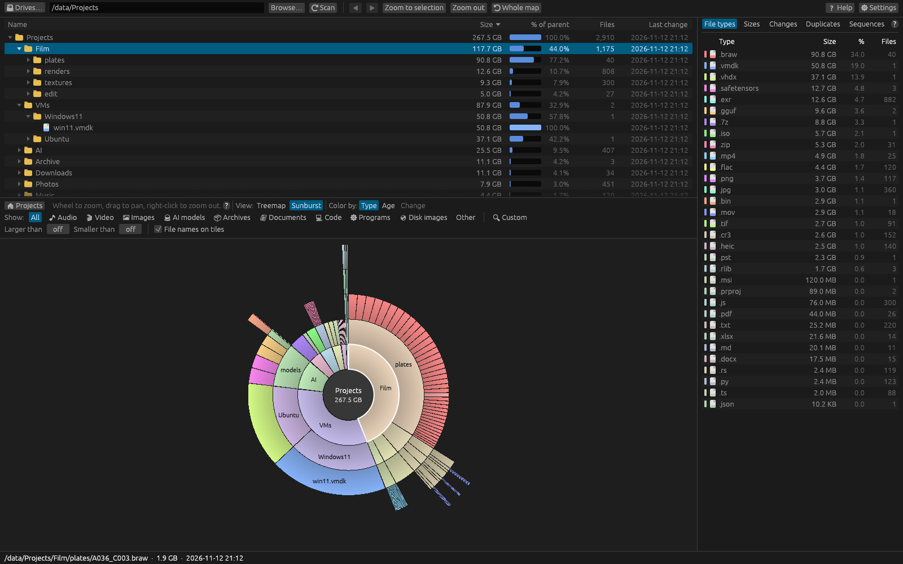

# The sunburst

Choose **View: Sunburst** in the filter bar to see the same scan as a ring chart.

## Reading it

- The **circle in the middle** is the folder being shown, with its name and total size.
- The **first ring** holds that folder's contents; each ring further out is **one folder level
  deeper**. Up to six rings are shown at once.
- Each segment's **angle is proportional to its size**: a folder using a quarter of the space
  takes a quarter of the ring.
- **Files** are coloured by the current colour mode (by type, unless you choose otherwise).
- With **Color by: Type**, **folders** are coloured by which top-level folder they belong to,
  getting darker further out, so you can follow one branch outwards. With **Age** they are grey,
  so the files stand out; with **Change** they take a darker version of their change colour.
- Segments too thin to see (under about a fifth of a degree) are left out.
- With **File names on tiles** on, names are written on segments with room for them.

## Using it

| Action | What it does |
|---|---|
| Hover | Shows the item's path, size and date in the status bar. |
| Click a segment | Selects it (the file manager opens to show it). |
| Double-click a segment | Makes that folder (or a file's folder) the centre. |
| Wheel forward | Moves into the top-level folder under the pointer. |
| Wheel back | Goes up one level. |
| Click the middle, or right-click | Goes up one level. |

**Zoom to selection** makes the selected folder (or the folder of the selected file) the
centre, **Zoom out** goes up one level and **⟲ Whole map** returns to the whole scan. Back and
Forward work on the treemap and in the file manager only.

The treemap and the sunburst share the same position: the folder you open in one is the folder
shown when you switch to the other. The [file manager](file-browser.md) above follows it too.

## When to use which

The **treemap** is best for spotting individual large files, because every file has its own
rectangle. The **sunburst** is best for seeing the folder structure: how deep things go and how
space splits between a few top-level folders.

## Related topics

- [The treemap](treemap.md)
- [Colour modes](color-modes.md)
- [Mouse controls](../reference/mouse.md)
