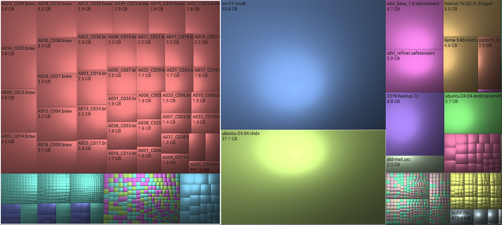
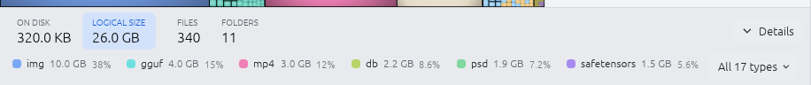

# The treemap

## What the rectangles mean

The treemap shows the folder named in the breadcrumbs above it (at first, everything you
scanned) as one big rectangle, divided up among its contents:

- **Each rectangle is one file.** Its **area is proportional to the file's size**: a file twice as
  big gets twice the area. The shape (tall, wide or square) means nothing; Filescape keeps
  rectangles as square as it can so they're easy to compare.
- **Files in the same folder sit together.** A folder is the region made up of all its files,
  and folders inside it are smaller regions within that.
- **Folders aren't drawn as boxes.** Instead each folder's region is shaded like a cushion,
  brighter in the middle and darker at the edges, so the borders between folders show up as
  creases. This is the "cushion treemap" technique used by WinDirStat.

Empty folders and empty files take no space and so don't appear on the map.

## What the colours mean

With **Color by: Type** (the default), the colour shows the file's extension, matching the
swatches in the **File types** list. Other colour modes show age or change since a snapshot; see
[Colour modes](color-modes.md). Empty dark areas are files a filter has hidden; see
[Filtering overview](../filtering/overview.md).

## The summary under the map

A line under the map sums up what it shows, like the map on filescape.app:

- the scanned folder, its total size and its number of files;
- a chip for each of the ten file types taking the most space, with its map colour and how much
  space those files take.

The summary **follows the filters.** Pick a category, set **Larger than** or **Smaller than**, or
type a Custom filter, and the totals become those of the matching files only, written as
"12.1 GB of 66.2 GB · 311 of 2,411 files", followed by the filters in words. The type chips are
recounted from the matches too, so raising **Larger than** shows at a glance which types the big
files are. While a new filter is being counted, a spinner shows beside the whole scan's totals.

**Click a chip** to highlight that type on the map, as clicking it in the **File types** list does;
click it again, or **Clear**, to stop. Hover a chip to see its share of the total. With **Color
by: Age** or **Change** only the totals line is shown, since the colours then mean something else.

## Finding out what something is

- **Hover** over a rectangle: the status bar shows its full path, size and modification date.
  A faint outline marks the folder that contains it.
- **Click** it to select it. A white outline marks the selection (you can change the colour in
  Settings > Treemap) and the file manager opens up to show it. If the selected item is too small
  to see at the current zoom, the smallest folder around it that is big enough is outlined
  instead.
- With **File names on tiles** turned on, names (and sizes, on taller tiles) are written on
  rectangles big enough to hold them, in white on a dark backing so they read on any colour.
  They fade in as you zoom in, and get bigger on bigger tiles.

## Previews on tiles

As you zoom in, a file's rectangle that grows big enough shows what's in the file instead of a
plain colour: a picture fills it, a video shows a frame (rest the pointer on it and it plays,
silently, until you move away), a sound shows its waveform, a PDF shows its first page, and text
files, code and Word or OpenDocument documents show their first lines. A Gaussian splat scene
shows the splats drawn on the graphics chip, with its format and splat count (such as
"SPZ · 1.2M splats") in the top corner. The file's name and size
move to a dark strip along the bottom, and a thin edge of the type colour stays round it.
Transparent parts of pictures show a grey check pattern, not the tile's colour. Bigger
tiles get sharper pictures and bigger text.

Previews load in the background, so zooming never waits for them, and only for tiles on screen.
Only files on this computer are read: a cloud file that isn't downloaded, a file on a mounted
cloud drive or a server, or one inside an archive keeps its plain colour, so zooming never
downloads anything. Turn previews off with **Previews** in the filter bar, or **Previews on
tiles** in Settings > Treemap.

## The preview pane

The **Preview** pane at the right of the map shows the item you clicked: a large preview of the
file (pictures can be zoomed and dragged, text scrolls, sound plays with the controls under it,
and a video's frame has a play button that plays it right there, with its sound, a bar to jump
about and **Open** to watch it in Quick Look on macOS or your video app elsewhere (on Linux,
playing in the pane needs `ffmpeg`; on Windows the pane plays the picture only, so use **Open**
for sound); a cloud file that isn't downloaded is only fetched if you ask), and its kind, size in bytes, size on disk, share of the analysis, date, where
it is and, for a cloud file, how it's stored. For a folder it lists the largest items inside;
click one to select it. **Open** opens the item and **Show in folder** (**Show in Finder** on macOS)
shows it in your file manager. Hide or show the pane with **Preview pane** in the filter bar or
**Alt+P** (**⌥P** on macOS).

### Quick Look on the map

Click a file's tile and press **Space** (or **Quick Look** in the preview pane) for a large
preview over the map, the same as in the File Manager. Click another tile and it follows.
**Full screen** (or **F**) fills the window with it, and **Space** or **Escape** closes it.

## Very small files

A drive can have millions of files too small to draw even as a single pixel. Filescape draws
everything down to about a pixel and fills the space of anything smaller with the average
colour of what's there, so a folder of many tiny files looks like a fine speckle of its main
colours rather than a gap. Zoom in and the individual files appear.

## Related topics

- [Navigating the treemap](treemap-navigation.md)
- [Colour modes](color-modes.md)
- [Lighting and visual effects](visual-effects.md)
- [Working with very large maps](large-maps.md)
