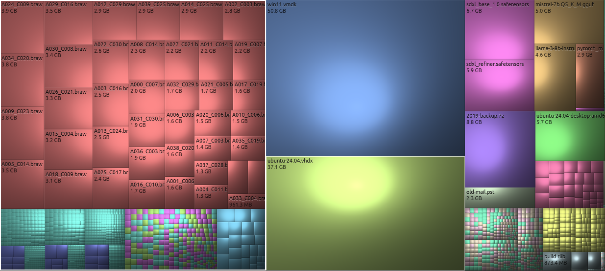

# The treemap

## What the rectangles mean

The treemap shows the folder named in the breadcrumbs above it (at first, everything you
scanned) as one big rectangle, divided up among its contents:

- **Each rectangle is one file.** Its **area is proportional to the file's size**: a file twice as
  big gets twice the area. The shape (tall, wide or square) means nothing; dirmap keeps
  rectangles as square as it can so they're easy to compare.
- **Files in the same folder sit together.** A folder is the region made up of all its files,
  and folders inside it are smaller regions within that.
- **Folders aren't drawn as boxes.** Instead each folder's region is shaded like a cushion,
  brighter in the middle and darker at the edges, so the borders between folders show up as
  creases. This is the "cushion treemap" technique used by WinDirStat.

Empty folders and empty files take no space and so don't appear on the map.

## What the colours mean

With **Color by: Type** (the default), the colour shows the file's extension, matching the
swatches in the **File types** list. Other colour modes show age or change since a snapshot; see
[Colour modes](color-modes.md). Empty dark areas are files a filter has hidden; see
[Filtering overview](../filtering/overview.md).

## Finding out what something is

- **Hover** over a rectangle: the status bar shows its full path, size and modification date.
  A faint outline marks the folder that contains it.
- **Click** it to select it. A white outline marks the selection (you can change the colour in
  Settings > Treemap) and the file manager opens up to show it. If the selected item is too small
  to see at the current zoom, the smallest folder around it that is big enough is outlined
  instead.
- With **File names on tiles** turned on, names (and sizes, on taller tiles) are written on
  rectangles big enough to hold them. They fade in as you zoom in.

## Very small files

A drive can have millions of files too small to draw even as a single pixel. dirmap draws
everything down to about a pixel and fills the space of anything smaller with the average
colour of what's there, so a folder of many tiny files looks like a fine speckle of its main
colours rather than a gap. Zoom in and the individual files appear.

## Related topics

- [Navigating the treemap](treemap-navigation.md)
- [Colour modes](color-modes.md)
- [Lighting and visual effects](visual-effects.md)
- [Working with very large maps](large-maps.md)
